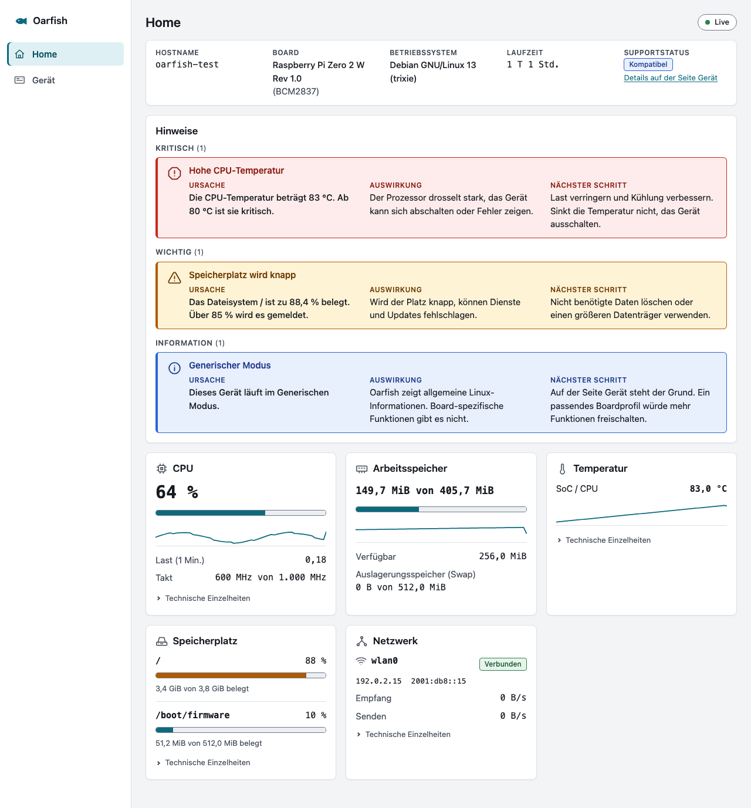

# User interface foundation

Oarfish has one app shell, one set of design tokens, a small set of components, designed states, and the pages built on them, in a light and a dark theme: Home and Gerät (UI foundation task, D-C42, D-C43), and since Gate G5.1 the access pages Einrichten (setup), Anmelden (login) and Konto (account), described in [`AUTH.md`](AUTH.md) and in [Access states](#access-states-gate-g51) below. The normative sources are specification 7 (GUI principles), ORB-GEN-003 (progressive disclosure), ORB-GEN-006 (texts from translation resources), ORB-NFR-006 (bundle size), ORB-NFR-011 (keyboard, WCAG 2.2 AA) and ORB-NFR-012 (browsers). Home itself is described in [`DASHBOARD.md`](DASHBOARD.md#home-page).

**Status: implemented and tested** with jsdom unit tests and with headless Chrome on one developer Mac (layout checks at five widths, reference screenshots). **Checked once on a Raspberry Pi Zero 2 W with `v0.1.0-alpha.5`** in Safari, Chrome and Firefox ([hardware result](INSTALL.md#ui-foundation-v010-alpha5)). **Not verified:** a screen reader, keyboard use in Safari, forced-colours mode in a real browser, the lost-connection display on the device. See [Verification status](#verification-status) and [Known gaps](#known-gaps).

The tokens in this file are named and explicit on purpose. They are meant to be carried into a design tool and back. The source of truth is [`frontend/src/styles/tokens.css`](../frontend/src/styles/tokens.css); `tokens.test.ts` fails when a token this file lists is missing there, and `docs.test.ts` fails when this file lacks a token, a component or a text that the code has.

## Contents

1. [Code layout](#code-layout)
2. [Design tokens](#design-tokens)
3. [Components](#components)
4. [Layout rules and breakpoints](#layout-rules-and-breakpoints)
5. [States](#states)
6. [State and label texts](#state-and-label-texts)
7. [Text rules](#text-rules)
8. [Accessibility](#accessibility)
9. [Data-driven rendering](#data-driven-rendering)
10. [Add a page](#add-a-page)
11. [Add a card](#add-a-card)
12. [Reference screenshots](#reference-screenshots)
13. [Size and performance](#size-and-performance)
14. [Verification status](#verification-status)
15. [Known gaps](#known-gaps)

## Code layout

```text
frontend/src/
  main.ts                  mounts App, imports the two style files
  App.svelte               router (hash) and AppShell
  routes.ts                the list of pages: the only place that knows them
  styles/tokens.css        every colour, space, size and duration (both themes)
  styles/base.css          element defaults, focus ring, utilities, forced colours, reduced motion
  styles/contrast-pairs.ts every text and graphic colour pair with its WCAG minimum
  components/              the reusable components (below)
  pages/Home.svelte        Home, built on the components
  pages/Device.svelte      Gerät, built on the components
  pages/Setup.svelte       Einrichten: first start with the setup token (G5.1)
  pages/Login.svelte       Anmelden (G5.1)
  pages/Account.svelte     Konto: change the password (G5.1), reached from the user menu
  lib/session.ts           the session client; the CSRF token lives in its module variable only
  lib/authErrors.ts        error codes of the access endpoints to sentences
  lib/ui.ts                tones, and how API values map to them
  lib/icons.ts             the own icon set (inline SVG paths)
  lib/contrast.ts          WCAG contrast maths in plain TypeScript
  lib/locales/de.ts, en.ts the texts, in two named groups
```

Production code contains no interface, port, hardware address or board name (D-C43); a test scans for them.

## Design tokens

All values are CSS custom properties on `:root` in `tokens.css`. The light set is the default. The dark set replaces only colours and shadows and follows `prefers-color-scheme: dark`. There is no theme switch and no setting. `color-scheme: light dark` is set, so scrollbars and form controls follow the active theme. Under `forced-colors: active` the system colours decide; borders, outlines and shapes carry the meaning (`base.css` and the components).

Colour roles:

- **Surfaces.** `page` is the grey background, `surface` is a card, `surface-muted` is a track or a hover.
- **Text.** `text`, `text-secondary` and `text-disabled`. All three pass 4.5:1 on every surface.
- **Borders.** `border` separates parts and is decorative. `border-strong` outlines a part that must be seen (meter, button, indicator) and passes 3:1.
- **Accent.** One colour, `accent`, for links, the current navigation entry, sparklines and normal meter fills. It is not a status.
- **Semantic roles.** `success`, `information`, `warning`, `critical`, each with `-bg`, `-fg` and `-border`. Warning and critical are reserved for real alerts and real problems (an alert, a lost connection, an unsupported device). `neutral` is not a status: it is for "no link", "unknown" and "not available".
- **Focus.** `focus-ring`, 2 px with a 2 px offset, on every focusable element.

Breakpoint (media queries cannot read custom properties): the shell changes from sidebar to top bar **below 60rem** (960 CSS pixels at the default text size, wider when the text is larger). Nothing else needs a breakpoint: cards, the summary strip, alert columns and key-value rows are intrinsic grids and wrapping rows.

**Colour**

| Token | Light | Dark |
|---|---|---|
| `--color-page` | `#f3f4f6` | `#0f1318` |
| `--color-surface` | `#ffffff` | `#171c23` |
| `--color-surface-muted` | `#eceef2` | `#202731` |
| `--color-text` | `#161a20` | `#e8ebf0` |
| `--color-text-secondary` | `#454d5a` | `#aeb7c4` |
| `--color-text-disabled` | `#5f6775` | `#8a94a3` |
| `--color-border` | `#dde1e7` | `#2a313b` |
| `--color-border-strong` | `#6f798a` | `#6f7a89` |
| `--color-accent` | `#0b6b7d` | `#52b6cb` |
| `--color-accent-fg` | `#ffffff` | `#04232b` |
| `--color-accent-subtle-bg` | `#dff0f4` | `#12343c` |
| `--color-accent-subtle-fg` | `#08505f` | `#93d6e5` |
| `--color-focus-ring` | `#1a56db` | `#7db2ff` |
| `--color-success-bg` | `#e6f4ea` | `#12301f` |
| `--color-success-fg` | `#14532d` | `#92dfad` |
| `--color-success-border` | `#2f7d4f` | `#3fa86a` |
| `--color-information-bg` | `#e8effd` | `#14264d` |
| `--color-information-fg` | `#1e3a8a` | `#a9c6ff` |
| `--color-information-border` | `#2c64d1` | `#5b8fe8` |
| `--color-warning-bg` | `#fff3d6` | `#3a2a08` |
| `--color-warning-fg` | `#6b3a00` | `#ffd58a` |
| `--color-warning-border` | `#b05a00` | `#d9922b` |
| `--color-critical-bg` | `#fdeceb` | `#3d1713` |
| `--color-critical-fg` | `#8a1c13` | `#ffb3aa` |
| `--color-critical-border` | `#c42b1c` | `#ef6a5b` |
| `--color-neutral-bg` | `#eceff3` | `#222a35` |
| `--color-neutral-fg` | `#3a424e` | `#c4ccd8` |
| `--color-neutral-border` | `#6f798a` | `#6f7a89` |

**Spacing**

| Token | Light | Dark |
|---|---|---|
| `--space-1` | `0.25rem` | same |
| `--space-2` | `0.5rem` | same |
| `--space-3` | `0.75rem` | same |
| `--space-4` | `1rem` | same |
| `--space-5` | `1.5rem` | same |
| `--space-6` | `2rem` | same |
| `--space-7` | `3rem` | same |
| `--space-8` | `4rem` | same |

**Radius**

| Token | Light | Dark |
|---|---|---|
| `--radius-sm` | `4px` | same |
| `--radius-md` | `6px` | same |
| `--radius-lg` | `8px` | same |
| `--radius-full` | `999px` | same |

**Font**

| Token | Light | Dark |
|---|---|---|
| `--font-sans` | `system-ui, -apple-system, 'Segoe UI', Roboto, 'Helvetica Neue', Arial, sans-serif` | same |
| `--font-mono` | `ui-monospace, 'SF Mono', SFMono-Regular, Menlo, Consolas, 'Liberation Mono', monospace` | same |

**Text size**

| Token | Light | Dark |
|---|---|---|
| `--text-xs` | `0.75rem` | same |
| `--text-sm` | `0.8125rem` | same |
| `--text-md` | `0.9375rem` | same |
| `--text-lg` | `1.0625rem` | same |
| `--text-xl` | `1.375rem` | same |
| `--text-2xl` | `1.875rem` | same |

**Weight**

| Token | Light | Dark |
|---|---|---|
| `--weight-regular` | `400` | same |
| `--weight-medium` | `500` | same |
| `--weight-semibold` | `600` | same |

**Line height**

| Token | Light | Dark |
|---|---|---|
| `--leading-tight` | `1.2` | same |
| `--leading-snug` | `1.35` | same |
| `--leading-normal` | `1.5` | same |

**Elevation**

| Token | Light | Dark |
|---|---|---|
| `--shadow-card` | `0 1px 2px 0 rgb(16 24 32 / 0.06)` | `0 1px 2px 0 rgb(0 0 0 / 0.4)` |
| `--shadow-raised` | `0 4px 12px 0 rgb(16 24 32 / 0.1)` | `0 4px 12px 0 rgb(0 0 0 / 0.5)` |

**Focus**

| Token | Light | Dark |
|---|---|---|
| `--focus-ring-width` | `2px` | same |
| `--focus-ring-offset` | `2px` | same |

**Motion**

| Token | Light | Dark |
|---|---|---|
| `--duration-fast` | `120ms` | same |
| `--duration-base` | `200ms` | same |
| `--ease-standard` | `cubic-bezier(0.2, 0, 0, 1)` | same |

**State**

| Token | Light | Dark |
|---|---|---|
| `--opacity-stale` | `0.85` | same |

**Layout**

| Token | Light | Dark |
|---|---|---|
| `--sidebar-width` | `14rem` | same |
| `--content-max` | `80rem` | same |
| `--target-min` | `1.5rem` | same |

## Components

All components are Svelte 5 with TypeScript and no dependency. They hold no UI text; texts come from `lib/locales`. Interactive elements are always native (`a`, `button`, `summary`).

| Component | Purpose | Props | States and behaviour |
|---|---|---|---|
| `AppShell` | Skip link, banner with brand and navigation, main area. Below 60rem the sidebar is a top bar. | `items` (navigation entries), `current` (id), `account` (the user menu), `children` | Current entry has `aria-current="page"`, a tint and a bar, so it is not shown by colour alone. The skip link moves focus to `main` and never changes the address. |
| `AuthShell` | The frame before sign-in (checking, setup, login): brand bar and one narrow column in `main`. No navigation, no device data. | `children` | One `main` landmark; the page inside has the `h1`. |
| `BrandMark` | The Oarfish mark, decorative. | none | `aria-hidden`; the brand name next to it is the text. |
| `UserMenu` | The signed-in user in the shell: a native `details` whose `summary` is the user name; inside, the link to Konto and the Abmelden button. | `username`, `accountHref`, `current`, `onLogout`, `busy` | The summary's accessible name is "Benutzermenü: <name>". Opened with Enter or Space. Not a live region. |
| `FormField` | Label, optional help, input and the field's own error, tied together with `for`, `aria-describedby` and `aria-invalid`. | `id`, `label`, `value` (bindable), `type` (`text`, `password`), `autocomplete`, `help`, `error`, `disabled`, `input` (bindable element) | Always `autocapitalize="off"` and `spellcheck="false"`. An error adds a 2 px critical border and the error text below the field, never colour alone. |
| `FormMessage` | The message area of a form. | `tone`, `testid` | `role="alert"` for `critical` (announced at once), `role="status"` otherwise. A new error is a new node, so the same sentence is announced again. |
| `PageHeader` | The one `h1` of a page and an optional small aside. | `title`, `aside` | Wraps on a narrow screen. |
| `Card` | A labelled section with a heading (`<id>-heading`), an icon and a body. | `id`, `title`, `icon`, `stale`, `wide` | `stale`: the body is dimmed to `--opacity-stale` (contrast is tested at that opacity) and the header shows the Veraltet badge. |
| `SummaryStrip` | The row at the top of Home: host name, board, operating system, uptime, support status. A group, not a section. | `items`, `label`, `stale` | The host name is cut to one line with the full text as `title`; other values wrap. A missing value is a neutral placeholder. |
| `Badge` | A short status word. | `tone` (`neutral`, `success`, `information`, `warning`, `critical`), `icon` | The text is the meaning; the icon and colour only support it. |
| `Notice` | A sentence or two that explains a state, with an icon. Not a live region. | `tone` | Used for the lost-connection explanation and the support explanation. |
| `AlertList` | The alerts, grouped by level with a count per level. The only live region (`aria-live="polite"`). | `alerts` | No alerts: one calm line. |
| `AlertItem` | One alert: level icon, short title (if the rule has one), then cause, impact and next step in columns. | `alert` | Columns stack on a narrow card. The level is told by icon shape, heading text and colour. |
| `Meter` | A usage bar. A native `progress` element with an accessible name. | `value`, `label`, `level` (`ok`, `relevant`, `critical`) | `ok` is the accent; the other two use warning and critical, like the storage alerts. The fill does not animate. |
| `Sparkline` | A small inline-SVG line of the last minutes. | `values`, `min`, `max`, `label` | An image with a text alternative. Fewer than two values: the text "Noch kein Verlauf". It is redrawn only when new data arrives. |
| `KeyValueList` | Label and value pairs as a definition list. | `items` (`label`, `value`, `note`, `mono`, `placeholder`, `title`, `testid`) | Never collapses (see [Layout rules](#layout-rules-and-breakpoints)). `null` shows a neutral placeholder. |
| `ConnectionIndicator` | A small pill at the top right of Home. | `state` | `live`, `connecting`, `reconnecting`, `stale`, `paused`, each with its own text. Not a live region. |
| `EmptyState` | A state without data: loading, error, or "nothing found". | `icon`, `tone`, `title`, `description`, `compact`, `role` | Full size on a page, `compact` inside a card. Only an error state gets `role="alert"`. |
| `Icon` | One of the own icons, decorative (`aria-hidden`). | `name` | Sizes with the text (`1.25em`), colour is `currentColor`. |

Icons: `home`, `device`, `chip`, `memory`, `thermometer`, `drive`, `network`, `wifi`, `ethernet`, `info`, `warning`, `critical`, `success`, `clock`, `user`, `lock`. They are 24 by 24 outline paths drawn for this project, so there is no icon library and no third-party licence. The icon for an interface follows the API field `kind` (`wifi`, `ethernet`, else the generic `network`).

## Layout rules and breakpoints

- **Shell.** At 60rem and wider: a 14rem sidebar (brand, navigation) and the content area, which is centred and at most 80rem wide. Below 60rem: a top bar with the brand and the navigation entries in a row that wraps, and the content below. The top bar scrolls away; nothing is `sticky` in the narrow layout, so a focused element is never hidden behind it (WCAG 2.4.11). The wide sidebar does not overlap content.
- **Cards.** An intrinsic grid: as many columns as fit, each at least 20rem (or the whole width when that is less). A wide card spans the row. No other breakpoint.
- **Label and value.** `KeyValueList` is a wrapping row, not a grid with fixed columns. Label and value sit side by side when they fit; when they do not, the value moves below the label. Neither is ever squeezed into a thin column. Long words break (`overflow-wrap: anywhere`) rather than overflow.
- **Grids inside grids** always declare `minmax(0, 1fr)` tracks, so a long unbreakable name can never widen a card.
- **Long names** (host name, interface, mount point, sensor) are one line with an ellipsis and the full text in `title`. Everything else wraps.
- **Units** are binary (`KiB`, `MiB`, `GiB`), never `MB` or `GB`. Numbers use the monospace face with tabular figures (`.num`).
- **Text size** is in `rem`, so the page follows the browser's text size. Nothing has a fixed height.

Checked at 320, 390, 768, 1280 and 1920 CSS pixels with a headless Chrome script (not part of the repository), for Home with a normal device, a device with the largest lists (8 interfaces, 8 mounts, 16 sensors, very long names, an unknown interface kind), a device with unknown values, Generic Mode, a lost connection and the Gerät page; and again at 320, 390 and 1280 with WCAG 1.4.12 text spacing (line height 1.5, letter spacing 0.12em, word spacing 0.16em, paragraph spacing 2em) and with the text size at 200 percent. Result: no horizontal scroll, no element outside the window, no clipped text, no label or value collapsed into a column narrower than 4rem, no interactive element smaller than 24 by 24 CSS pixels (links inside running text excepted). 320 CSS pixels is 400 percent zoom on a 1280 pixel window (WCAG 1.4.10).

## States

Each state is designed and has a test (`pages/Home.states.test.ts`, `pages/Home.test.ts`, `pages/Device.test.ts`).

| State | What the user sees | Test |
|---|---|---|
| Loading (first paint) | Page header, an `EmptyState` with "Werte werden geladen …", the indicator "Verbindet …". | `Home.states.test.ts` "state loading" |
| Live | Indicator "Live", values in place, no notice, no Veraltet. | "state live" |
| Connection lost | The last values stay, dimmed; every card and the strip say "Veraltet"; a notice says what happened and when the last update was. | "state connection lost" |
| Reconnecting | Indicator "Verbindet neu …". Without any data yet the page says "Verbindung wird aufgebaut …". Network rates show the last value (dimmed) or "Nicht verfügbar", never "wird ermittelt …". | "state reconnecting", "state reconnecting without data" |
| Open but silent | Indicator "Keine neuen Werte" and a notice, after 7 seconds without a value. | "state open but silent" |
| Paused | Indicator "Pausiert" (the tab was hidden; no stream is open). | "state paused" |
| Load error | `EmptyState` with the error, a hint and a retry button. | "state load error" |
| No alerts | One calm line with a check icon, inside the live region. While live it says "Keine Hinweise. Alles in Ordnung.". While the values are stale, the connection is lost or reconnecting, it says only "Beim letzten Abruf gab es keine Hinweise." | "state no alerts", "empty alert list" in `Home.states.test.ts` |
| One alert per level | Three groups with counts; each alert with icon, short title, cause, impact and next step. | "state one alert per level" |
| No sensors, no storage, no interfaces | One plain line in the card. | "state no sensors, no storage, no interfaces" |
| Unknown values | A neutral placeholder ("Unbekannt", "Nicht verfügbar"), never an empty field, `null` or `NaN`. | "state unknown values" |
| Generic Mode | Neutral status badge, the informational alert, no board claim. | "state Generic Mode" |
| Very long host name | One line, ellipsis, full name as `title`. | "state very long host name" |
| Link states | `up` is a green "Verbunden". "Kein Link", "Unbekannt" and any state this version does not know are neutral grey, never a warning. | "shows a link state honestly" |
| Support tier | `verified` success, `compatible` information, `experimental` warning, `unsupported` critical, everything else neutral. | "colours the support status by tier" |

### Access states (Gate G5.1)

The app shows nothing of the dashboard until `GET /api/v1/session` has answered (ADR 0009). Tests: `pages/Auth.test.ts`, `lib/session.test.ts`, `App.test.ts`.

| State | What the user sees | Test |
|---|---|---|
| Checking the session | `AuthShell` with "Sitzung wird geprüft …"; no navigation, no request for device data, no stream. | `Auth.test.ts` "shows nothing of the dashboard before the session state is known" |
| Oarfish unreachable | "Oarfish ist nicht erreichbar." with the hint and "Erneut versuchen". | "says so when Oarfish cannot be reached, and tries again" |
| Setup required | Einrichten: setup code with the command `sudo cat /var/lib/oarfish/setup-token`, user name, password twice; a read-only section "Erreichbarkeit" says that Oarfish is reachable on this device only (loopback). There is no binding choice. Focus starts on the first field. | "names the command for the token, says that Oarfish listens on this device only, and has accessible fields" |
| Setup rule broken | The broken rule in the message area and at the field, the field marked invalid and focused, both password fields cleared. Nothing is sent. | "checks the rules before sending and names the broken one" |
| Setup token wrong | "Der Einrichtungscode stimmt nicht. …", focus on the setup code. | "shows the server answer for a wrong token, then sets up and opens the app" |
| Login | Anmelden: user name (`autocomplete="username"`), password (`current-password`); focus on the user name. | "has labelled fields with the right autocomplete and the focus on the user name" |
| Login failed | One sentence for a wrong user name and a wrong password; the password is cleared, the user name kept, focus on the password. | "gives the same sentence for a wrong user name and a wrong password, and clears the password" |
| Rate limited | "Zu viele Versuche. Warten Sie 8 Sekunden …" (minutes from two minutes on). | "shows the wait time when rate limited" |
| Session ended | Back on Anmelden with "Die Sitzung ist beendet. Melden Sie sich erneut an." after any 401, after the stream's last `session` event, or when a refused stream finds the session gone. The stream is closed and not reopened. | "returns to the login page with \"session ended\" on a 401, without a reconnect loop", "returns to the login page when the server ends the stream with the session event", "asks for the session before reconnecting a refused stream, and stops when it is gone" |
| Signed out | Back on Anmelden with "Sie sind abgemeldet."; the stream is closed. | "has a user menu with the account page and Abmelden, and logs out" |
| Account | Konto: "Angemeldet als …", the session lifetimes, the form current / new / repeat. Errors as above; success: "Das Passwort ist geändert. Alle anderen Sitzungen sind beendet." | "changes the password on the account page" |
| No secret in the browser | The CSRF token is in a module variable; neither it nor a password is in `localStorage`, `sessionStorage`, `document.cookie`, the address, the title or the page. | "signs in, keeps the token out of browser storage and the address, and sends no CSRF-free change", `session.test.ts` "reads the session state and keeps the CSRF token in memory only" |

Where stale values could read as a current claim (checked for the wording fix; only wording and marking were changed):

| Place | While stale, lost or reconnecting | Result |
|---|---|---|
| Empty alert list | "Beim letzten Abruf gab es keine Hinweise." | Fixed |
| Network rates | Last rate, dimmed with the card, or "Nicht verfügbar"; "wird ermittelt …" only while live | Fixed |
| Link badge "Verbunden" and addresses | Inside a dimmed card that says "Veraltet" | Marked by the card, unchanged |
| Meters, values, sparklines | Same, and the sparkline text says "zuletzt" | Marked by the card, unchanged |
| Summary strip | Dimmed, "Veraltet" badge | Marked, unchanged |
| Alerts that exist | Shown as they were at the last reading. The alerts card is not dimmed and has no Veraltet badge | Open: marking it needs a component change |
| Tab shown again after a pause | Old values show without Veraltet until the stream opens ("Verbindet …"); the two texts above are already cautious there | Open: needs a change in the stale logic |

The alert rules themselves (including the rule "no interface has a link") are unchanged and described in [`DASHBOARD.md`](DASHBOARD.md#alerts). The UI shows no alert for a single interface without a link.

## State and label texts

All texts the interface says about itself are in one group, `deUi` in [`frontend/src/lib/locales/de.ts`](../frontend/src/lib/locales/de.ts), with the same keys as `enUi` in `en.ts`. Lift this group in one piece. The sentences the API selects by key (alerts, support explanations, limitations, capabilities, and the short alert titles) are in the second group, `deApi`; they are not listed here. The German is the default language.

| Key | Deutsch | English |
|---|---|---|
| `brandName` | Oarfish | Oarfish |
| `skipLink` | Zum Inhalt springen | Skip to content |
| `navLabel` | Hauptnavigation | Main navigation |
| `navHome` | Home | Home |
| `navDevice` | Gerät | Device |
| `homeTitle` | Home | Home |
| `deviceTitle` | Gerät | Device |
| `connIndicatorLive` | Live | Live |
| `connIndicatorConnecting` | Verbindet … | Connecting … |
| `connIndicatorReconnecting` | Verbindet neu … | Reconnecting … |
| `connIndicatorStale` | Keine neuen Werte | No new values |
| `connIndicatorPaused` | Pausiert | Paused |
| `homeLoading` | Werte werden geladen … | Loading values … |
| `homeLoadError` | Die Werte konnten nicht geladen werden. | The values could not be loaded. |
| `homeLoadErrorHint` | Prüfen Sie, ob Oarfish auf dem Gerät läuft, und versuchen Sie es noch einmal. | Check that Oarfish is running on the device, then try again. |
| `homeRetry` | Erneut versuchen | Try again |
| `connConnecting` | Verbindung wird aufgebaut … | Connecting … |
| `connLost` | Die Verbindung ist unterbrochen. Die Werte sind veraltet. Oarfish verbindet sich automatisch neu. | The connection is lost. The values are out of date. Oarfish reconnects by itself. |
| `connStale` | Seit einigen Sekunden kommen keine neuen Werte an. Die Werte sind vielleicht veraltet. | No new values have arrived for a few seconds. The values may be out of date. |
| `connLastUpdate` | Letzte Aktualisierung: {time} | Last update: {time} |
| `staleBadge` | Veraltet | Out of date |
| `unknownValue` | Unbekannt | Unknown |
| `unavailableValue` | Nicht verfügbar | Not available |
| `technicalDetails` | Technische Einzelheiten | Technical details |
| `summaryHeading` | Überblick über das Gerät | Device overview |
| `sumHost` | Hostname | Host name |
| `sumBoard` | Board | Board |
| `sumSoc` | SoC | SoC |
| `sumOs` | Betriebssystem | Operating system |
| `sumUptime` | Laufzeit | Uptime |
| `sumSupport` | Supportstatus | Support status |
| `sumDeviceLink` | Details auf der Seite Gerät | Details on the Device page |
| `uptimeDaysHours` | {days} T {hours} Std. | {days} d {hours} h |
| `uptimeHoursMinutes` | {hours} Std. {minutes} Min. | {hours} h {minutes} min |
| `uptimeMinutes` | {minutes} Min. | {minutes} min |
| `alertsHeading` | Hinweise | Alerts |
| `alertsNone` | Keine Hinweise. Alles in Ordnung. | No alerts. Everything is in order. |
| `alertsNoneStale` | Beim letzten Abruf gab es keine Hinweise. | There were no alerts at the last reading. |
| `alertCause` | Ursache | Cause |
| `alertImpact` | Auswirkung | Impact |
| `alertNext` | Nächster Schritt | Next step |
| `level.critical` | Kritisch | Critical |
| `level.relevant` | Wichtig | Important |
| `level.informational` | Information | Information |
| `cpuHeading` | CPU | CPU |
| `cpuUsage` | Auslastung | Usage |
| `cpuLoad` | Last (1 Min.) | Load (1 min) |
| `cpuFreq` | Takt | Clock |
| `cpuFreqOfMax` | {current} von {max} | {current} of {max} |
| `cpuGovernor` | Governor | Governor |
| `cpuCores` | Kerne | Cores |
| `cpuLoadLong` | Last (5 / 15 Min.) | Load (5 / 15 min) |
| `cpuNoFreq` | Der Kernel meldet keinen Takt. | The kernel reports no clock speed. |
| `memHeading` | Arbeitsspeicher | Memory |
| `memUsed` | Belegt | In use |
| `memAvailable` | Verfügbar | Available |
| `memTotal` | Gesamt | Total |
| `memSwap` | Auslagerungsspeicher (Swap) | Swap |
| `memSwapNone` | Kein Swap eingerichtet | No swap configured |
| `memUsedOf` | {used} von {total} | {used} of {total} |
| `tempHeading` | Temperatur | Temperature |
| `tempNone` | Keine Temperatursensoren gefunden. | No temperature sensors found. |
| `tempSoc` | SoC / CPU | SoC / CPU |
| `tempSource` | Quelle | Source |
| `tempSensorId` | Sensor | Sensor |
| `tempSource.thermal_zone` | Thermal Zone | Thermal zone |
| `tempSource.hwmon` | Hardware-Monitor | Hardware monitor |
| `storageHeading` | Speicherplatz | Storage |
| `storageNone` | Kein Speicherplatz gefunden. | No storage found. |
| `storageUsedOf` | {used} von {total} belegt | {used} of {total} used |
| `storageFree` | Frei | Free |
| `storageFsType` | Dateisystem | File system |
| `netHeading` | Netzwerk | Network |
| `netNone` | Keine Netzwerkschnittstellen gefunden. | No network interfaces found. |
| `netAddresses` | Adressen | Addresses |
| `netNoAddress` | Keine Adresse | No address |
| `netRx` | Empfang | Receive |
| `netTx` | Senden | Send |
| `netSpeed` | Geschwindigkeit | Speed |
| `netTotals` | Übertragen seit dem Start | Transferred since boot |
| `netRateWaiting` | wird ermittelt … | measuring … |
| `netKind` | Art | Type |
| `linkState.up` | Verbunden | Connected |
| `linkState.down` | Kein Link | No link |
| `linkState.unknown` | Unbekannt | Unknown |
| `linkState.dormant` | Wartet | Waiting |
| `linkState.lowerlayerdown` | Kein Link | No link |
| `linkState.notpresent` | Nicht vorhanden | Not present |
| `linkState.testing` | Wird geprüft | Testing |
| `netKind.ethernet` | Ethernet | Ethernet |
| `netKind.wifi` | WLAN | Wi-Fi |
| `netKind.other` | Sonstige | Other |
| `sparkCpu` | CPU-Auslastung der letzten Minuten, zuletzt {value} | CPU usage over the last minutes, now {value} |
| `sparkMemory` | Belegter Arbeitsspeicher der letzten Minuten, zuletzt {value} | Memory in use over the last minutes, now {value} |
| `sparkTemperature` | Temperatur der letzten Minuten, zuletzt {value} | Temperature over the last minutes, now {value} |
| `sparkNoData` | Noch kein Verlauf | No history yet |
| `deviceLoading` | Geräteinformationen werden geladen … | Loading device information … |
| `deviceError` | Die Geräteinformationen konnten nicht geladen werden. | The device information could not be loaded. |
| `deviceErrorHint` | Prüfen Sie, ob Oarfish auf dem Gerät läuft, und laden Sie die Seite noch einmal. | Check that Oarfish is running on the device, then reload the page. |
| `deviceReload` | Erneut laden | Reload |
| `hardwareHeading` | Hardware | Hardware |
| `fieldModel` | Modell | Model |
| `fieldVendor` | Hersteller | Vendor |
| `fieldSoc` | SoC-Familie | SoC family |
| `fieldArch` | Architektur | Architecture |
| `fieldRevision` | Revisionscode | Revision code |
| `fieldMemory` | Arbeitsspeicher | Memory |
| `osHeading` | Betriebssystem | Operating system |
| `fieldOs` | System | System |
| `fieldOsAdapter` | Betriebssystem-Adapter | Operating system adapter |
| `fieldKernel` | Kernel | Kernel |
| `supportHeading` | Supportstatus | Support status |
| `fieldTier` | Stufe | Level |
| `fieldProfile` | Profil | Profile |
| `fieldMatchedBy` | Erkannt über | Recognised by |
| `limitationsHeading` | Bekannte Einschränkungen | Known limitations |
| `genericNoticeTitle` | Generischer Modus | Generic mode |
| `unsupportedNoticeTitle` | Nicht unterstützt | Not supported |
| `sensorsHeading` | Sensoren | Sensors |
| `fieldCpuTemp` | CPU-Temperatur | CPU temperature |
| `fieldBootMedium` | Bootmedium | Boot medium |
| `capabilitiesHeading` | Fähigkeiten | Capabilities |
| `capabilitiesIntro` | Oarfish bietet eine Funktion nur an, wenn die nötige Fähigkeit auf diesem Gerät gefunden wurde. | Oarfish only offers a function when the capability it needs was found on this device. |
| `capAvailable` | Verfügbar | Available |
| `capUnavailable` | Nicht verfügbar | Not available |
| `capDetails` | Technische Einzelheiten | Technical details |
| `capSource` | Geprüft | Probed |
| `capReason` | Grund | Reason |
| `tier.verified` | Verifiziert | Verified |
| `tier.compatible` | Kompatibel | Compatible |
| `tier.community` | Community | Community |
| `tier.experimental` | Experimentell | Experimental |
| `tier.generic` | Generisch | Generic |
| `tier.unsupported` | Nicht unterstützt | Unsupported |
| `navAccount` | Konto | Account |
| `accountTitle` | Konto | Account |
| `userMenuLabel` | Benutzermenü | User menu |
| `logout` | Abmelden | Sign out |
| `sessionLoading` | Sitzung wird geprüft … | Checking the session … |
| `sessionError` | Oarfish ist nicht erreichbar. | Oarfish cannot be reached. |
| `setupTitle` | Oarfish einrichten | Set up Oarfish |
| `setupIntro` | Legen Sie das Administratorkonto an. Ohne dieses Konto zeigt Oarfish keine Daten des Geräts. | Create the administrator account. Without it, Oarfish shows no data of the device. |
| `setupTokenLabel` | Einrichtungscode | Setup code |
| `setupTokenHelp` | Nur wer Zugang zum Gerät hat, kann ihn lesen. Zeigen Sie ihn dort mit diesem Befehl an: | Only someone with access to the device can read it. Show it there with this command: |
| `setupTokenCommand` | sudo cat /var/lib/oarfish/setup-token | sudo cat /var/lib/oarfish/setup-token |
| `setupBindingHeading` | Erreichbarkeit | Reachability |
| `setupBinding` | Oarfish ist nur auf diesem Gerät erreichbar (Loopback, 127.0.0.1). Von einem anderen Rechner aus nutzen Sie einen SSH-Tunnel. | Oarfish can only be reached on this device (loopback, 127.0.0.1). From another computer, use an SSH tunnel. |
| `usernameLabel` | Benutzername | User name |
| `usernameHelp` | 1 bis 32 Zeichen: Kleinbuchstaben, Ziffern, Punkt, Bindestrich und Unterstrich. | 1 to 32 characters: lower-case letters, digits, dot, hyphen and underscore. |
| `passwordLabel` | Passwort | Password |
| `newPasswordHelp` | Mindestens 12 Zeichen. Mehrere Wörter sind leicht zu merken. | At least 12 characters. Several words are easy to remember. |
| `passwordRepeatLabel` | Passwort wiederholen | Repeat the password |
| `setupSubmit` | Konto anlegen | Create account |
| `setupWorking` | Konto wird angelegt … | Creating the account … |
| `loginTitle` | Anmelden | Sign in |
| `loginIntro` | Melden Sie sich mit dem Administratorkonto an. | Sign in with the administrator account. |
| `loginSubmit` | Anmelden | Sign in |
| `loginWorking` | Anmeldung läuft … | Signing in … |
| `loginExpired` | Die Sitzung ist beendet. Melden Sie sich erneut an. | The session has ended. Sign in again. |
| `loginLoggedOut` | Sie sind abgemeldet. | You are signed out. |
| `accountSignedInAs` | Angemeldet als {user}. | Signed in as {user}. |
| `accountSessionNote` | Eine Sitzung endet nach einer Stunde ohne Aktivität, spätestens nach zwölf Stunden. | A session ends after one hour without activity, at the latest after twelve hours. |
| `accountPasswordHeading` | Passwort ändern | Change password |
| `currentPasswordLabel` | Aktuelles Passwort | Current password |
| `newPasswordLabel` | Neues Passwort | New password |
| `newPasswordRepeatLabel` | Neues Passwort wiederholen | Repeat the new password |
| `accountSubmit` | Passwort ändern | Change password |
| `accountWorking` | Passwort wird geändert … | Changing the password … |
| `accountChanged` | Das Passwort ist geändert. Alle anderen Sitzungen sind beendet. | The password is changed. All other sessions have ended. |
| `errorCredentials` | Benutzername oder Passwort ist falsch. | The user name or the password is wrong. |
| `errorRateLimitedSeconds` | Zu viele Versuche. Warten Sie {seconds} Sekunden und versuchen Sie es dann erneut. | Too many attempts. Wait {seconds} seconds, then try again. |
| `errorRateLimitedMinutes` | Zu viele Versuche. Warten Sie {minutes} Minuten und versuchen Sie es dann erneut. | Too many attempts. Wait {minutes} minutes, then try again. |
| `errorSetupToken` | Der Einrichtungscode stimmt nicht. Lesen Sie ihn auf dem Gerät erneut aus. | The setup code is wrong. Read it again on the device. |
| `errorSetupDone` | Das Administratorkonto ist schon eingerichtet. Melden Sie sich an. | The administrator account exists already. Sign in. |
| `errorUsername` | Dieser Benutzername ist nicht erlaubt. Erlaubt sind 1 bis 32 Kleinbuchstaben, Ziffern, Punkt, Bindestrich und Unterstrich. | This user name is not allowed. Allowed are 1 to 32 lower-case letters, digits, dot, hyphen and underscore. |
| `errorPasswordShort` | Das Passwort ist zu kurz. Es braucht mindestens 12 Zeichen. | The password is too short. It needs at least 12 characters. |
| `errorPasswordLong` | Das Passwort ist zu lang. Es darf höchstens 128 Zeichen haben. | The password is too long. It may have at most 128 characters. |
| `errorPasswordCommon` | Dieses Passwort ist zu verbreitet. Wählen Sie ein anderes. | This password is too common. Choose another one. |
| `errorPasswordInvalid` | Das Passwort enthält ein Zeichen, das nicht erlaubt ist. | The password contains a character that is not allowed. |
| `errorPasswordMismatch` | Die beiden Passwörter sind nicht gleich. | The two passwords are not the same. |
| `errorCurrentPassword` | Das aktuelle Passwort ist falsch. | The current password is wrong. |
| `errorRequired` | Dieses Feld ist leer. | This field is empty. |
| `errorNetwork` | Oarfish ist nicht erreichbar. Prüfen Sie die Verbindung und versuchen Sie es erneut. | Oarfish cannot be reached. Check the connection and try again. |
| `errorGeneric` | Das hat nicht funktioniert. Versuchen Sie es erneut. | That did not work. Try again. |

## Text rules

For the state and label texts (`deUi`, German and English). `i18n.test.ts` checks the mechanical ones.

1. Plain language, short sentences (at most 20 words), everyday words.
2. No exclamation marks, no emojis, no filler ("bitte", "leider", "einfach"), no marketing tone.
3. Name the state and what happens next: "Die Verbindung ist unterbrochen. Die Werte sind veraltet. Oarfish verbindet sich automatisch neu."
4. One term for one thing: **Arbeitsspeicher** (not RAM), **Speicherplatz** (not Festplatte or Datenträger), **Netzwerk**, **Hinweis** (not Warnung or Alarm), **Werte**, **Gerät**. The alert level `relevant` reads "Wichtig".
5. A missing value is "Unbekannt" (we cannot tell) or "Nicht verfügbar" (the device does not provide it), never blank.
6. Use the typographic ellipsis "…" for work in progress, not three dots.
7. Numbers follow the German format (decimal comma, thousands point); units are binary.
8. Old values never claim that all is fine and never promise a measurement. A statement about the present ("Keine Hinweise. Alles in Ordnung.", "wird ermittelt …") is shown only while the stream is live; otherwise the text says what was true at the last reading, or "Nicht verfügbar".
9. A text is never in a component. A new text is added to `deUi` and `enUi` together.

## Accessibility

Target: WCAG 2.2 AA (ORB-NFR-011). What is tested and what is not is in [Verification status](#verification-status).

- **Contrast.** Text 4.5:1, UI components and graphics 3:1, in both themes. `tokens.test.ts` computes the ratio of every pair in `styles/contrast-pairs.ts` (56 pairs, including small labels, badges, the disabled look, the focus ring, meter fills on their track, and every semantic role) and fails below the minimum. It also checks the dimmed stale values at their real opacity. The table is below.
- **Colour is never the only signal.** Alert level: icon shape, group heading, colour. Link state: badge text. Stale: the word Veraltet. Current page: `aria-current`, tint and bar. Meter: the value is written next to it.
- **Focus.** One visible ring (`--focus-ring-*`) with 3:1 against every background. No sticky element covers a focused element.
- **Target size.** Buttons, navigation entries, `summary` and links are at least 24 by 24 CSS pixels (`--target-min`).
- **Landmarks and headings.** `header` (banner, with the navigation), `nav` with a name, `main`. One `h1` per page; `h2` for cards, `h3` for alert groups, `h4` for alert titles; no level is skipped. A skip link is the first focusable element.
- **Native elements.** Only `a`, `button`, `summary` and, on the access pages, labelled `input` elements are interactive. No `tabindex` above 0, no `role="button"`. Forms submit with Enter.
- **Live region.** On Home only the alert list has `aria-live`, exactly as before. The connection indicator, the notices and the metric values are not announced. The Gerät page keeps its loading and error roles. The forms of Einrichten, Anmelden and Konto each have one message area (`FormMessage`): errors as `role="alert"`, the expired and signed-out notes and the success note as `role="status"`.
- **Forms.** Every field has a visible label and, where it helps, a help text tied with `aria-describedby`. An error names the rule, marks the field with `aria-invalid` and a thicker border, and moves the focus to the field. Password fields are cleared after every submit. On a page change the focus goes to the first field.
- **Images and icons.** Icons are `aria-hidden`. A sparkline is an image with a text alternative that includes the latest value. A meter has an accessible name and its value.
- **Motion.** Nothing animates when a value updates (no transition on a bar, no animation at all). Hover and open effects use `--duration-*`, which `prefers-reduced-motion` sets to zero.
- **Colour schemes and forced colours.** `color-scheme: light dark`; `forced-colors: active` rules for focus, borders, meters, the indicator dot and the current entry.
- **Reflow and text spacing.** See [Layout rules](#layout-rules-and-breakpoints).

Contrast of every pair (ratios computed from the token values; all are at or above their minimum):

| Foreground on background | Min | Light | Dark | Use |
|---|---|---|---|---|
| `text` on `page` | 4.5 | 15.87 | 15.60 | body text |
| `text-secondary` on `page` | 4.5 | 7.75 | 9.20 | labels, small print, placeholders |
| `text-disabled` on `page` | 4.5 | 5.18 | 6.08 | disabled button text |
| `accent` on `page` | 4.5 | 5.59 | 7.91 | links |
| `text` on `surface` | 4.5 | 17.46 | 14.32 | body text |
| `text-secondary` on `surface` | 4.5 | 8.53 | 8.45 | labels, small print, placeholders |
| `text-disabled` on `surface` | 4.5 | 5.70 | 5.58 | disabled button text |
| `accent` on `surface` | 4.5 | 6.15 | 7.26 | links |
| `text` on `surface-muted` | 4.5 | 15.03 | 12.59 | body text |
| `text-secondary` on `surface-muted` | 4.5 | 7.34 | 7.43 | labels, small print, placeholders |
| `text-disabled` on `surface-muted` | 4.5 | 4.91 | 4.90 | disabled button text |
| `accent` on `surface-muted` | 4.5 | 5.30 | 6.38 | links |
| `accent-fg` on `accent` | 4.5 | 6.15 | 6.96 | skip link |
| `accent-subtle-fg` on `accent-subtle-bg` | 4.5 | 7.71 | 8.21 | current navigation entry |
| `success-fg` on `success-bg` | 4.5 | 8.02 | 9.11 | success badge, notice, alert |
| `success-fg` on `surface` | 4.5 | 9.11 | 10.91 | success text on a card |
| `text` on `success-bg` | 4.5 | 15.38 | 11.97 | success alert body text |
| `text-secondary` on `success-bg` | 4.5 | 7.51 | 7.06 | success notice secondary line |
| `information-fg` on `information-bg` | 4.5 | 8.98 | 8.63 | information badge, notice, alert |
| `information-fg` on `surface` | 4.5 | 10.36 | 9.95 | information text on a card |
| `text` on `information-bg` | 4.5 | 15.13 | 12.43 | information alert body text |
| `text-secondary` on `information-bg` | 4.5 | 7.39 | 7.33 | information notice secondary line |
| `warning-fg` on `warning-bg` | 4.5 | 8.54 | 9.99 | warning badge, notice, alert |
| `warning-fg` on `surface` | 4.5 | 9.42 | 12.34 | warning text on a card |
| `text` on `warning-bg` | 4.5 | 15.83 | 11.60 | warning alert body text |
| `text-secondary` on `warning-bg` | 4.5 | 7.73 | 6.85 | warning notice secondary line |
| `critical-fg` on `critical-bg` | 4.5 | 8.14 | 9.23 | critical badge, notice, alert |
| `critical-fg` on `surface` | 4.5 | 9.31 | 10.01 | critical text on a card |
| `text` on `critical-bg` | 4.5 | 15.28 | 13.21 | critical alert body text |
| `text-secondary` on `critical-bg` | 4.5 | 7.46 | 7.79 | critical notice secondary line |
| `neutral-fg` on `neutral-bg` | 4.5 | 8.80 | 8.95 | neutral badge, notice, alert |
| `neutral-fg` on `surface` | 4.5 | 10.15 | 10.58 | neutral text on a card |
| `text` on `neutral-bg` | 4.5 | 15.14 | 12.11 | neutral alert body text |
| `text-secondary` on `neutral-bg` | 4.5 | 7.39 | 7.15 | neutral notice secondary line |
| `border-strong` on `page` | 3 | 3.99 | 4.28 | outline of meters, buttons, indicator |
| `border-strong` on `surface` | 3 | 4.40 | 3.93 | outline of meters, buttons, indicator |
| `border-strong` on `surface-muted` | 3 | 3.78 | 3.45 | outline of meters, buttons, indicator |
| `accent` on `surface` | 3 | 6.15 | 7.26 | sparkline, normal meter fill |
| `accent` on `surface-muted` | 3 | 5.30 | 6.38 | normal meter fill on its track |
| `warning-border` on `surface-muted` | 3 | 4.20 | 5.80 | warning meter fill on its track |
| `critical-border` on `surface-muted` | 3 | 4.87 | 4.93 | critical meter fill on its track |
| `focus-ring` on `page` | 3 | 5.62 | 8.60 | focus ring |
| `focus-ring` on `surface` | 3 | 6.18 | 7.89 | focus ring |
| `focus-ring` on `surface-muted` | 3 | 5.32 | 6.94 | focus ring |
| `focus-ring` on `accent-subtle-bg` | 3 | 5.27 | 6.12 | focus ring |
| `accent` on `accent-subtle-bg` | 3 | 5.25 | 5.63 | current entry bar |
| `success-border` on `surface` | 3 | 5.04 | 5.72 | success border and dot |
| `success-border` on `success-bg` | 3 | 4.44 | 4.78 | success border against its own fill |
| `information-border` on `surface` | 3 | 5.45 | 5.33 | information border and dot |
| `information-border` on `information-bg` | 3 | 4.73 | 4.62 | information border against its own fill |
| `warning-border` on `surface` | 3 | 4.87 | 6.60 | warning border and dot |
| `warning-border` on `warning-bg` | 3 | 4.42 | 5.35 | warning border against its own fill |
| `critical-border` on `surface` | 3 | 5.66 | 5.61 | critical border and dot |
| `critical-border` on `critical-bg` | 3 | 4.95 | 5.17 | critical border against its own fill |
| `neutral-border` on `surface` | 3 | 4.40 | 3.93 | neutral border and dot |
| `neutral-border` on `neutral-bg` | 3 | 3.81 | 3.32 | neutral border against its own fill |


## Data-driven rendering

D-C43: the UI renders what the API sends.

- No interface, port, hardware address or board name is in the UI code. `Home.data.test.ts` scans every production `.svelte`, `.ts` and `.css` file outside the locale files.
- Icons and labels follow the API field `kind` (`wifi`, `ethernet`, `other`). A kind this version does not know gets the neutral generic icon and the label "Sonstige".
- A value the translations do not know (a link state, a sensor source) gets the neutral wording. The existing rule stays for texts chosen by a key (support explanation, limitation): an unknown key is shown as the key itself, so a gap is visible.
- Lists render up to the API caps: 8 interfaces, 8 mounts, 16 sensors. Long names are cut with the full text in `title`.
- The mapping from API vocabulary to a look (support tier to tone, link state to tone) is keyed by the API's own enumerations in `lib/ui.ts`, never by a device.

## Add a page

1. Create `frontend/src/pages/<Name>.svelte`. Start with `<PageHeader title={t.…} />` and put the content in `Card`s inside a `<div class="card-grid">`.
2. Add its title to `deUi` and `enUi` (for example `navSystem`, `systemTitle`).
3. Add one entry to `routes` in `frontend/src/routes.ts`: `id`, `path` (`#/system`), `labelKey`, `icon`, `component`. That adds the navigation entry, the route and the tab title. Nothing else changes.
4. Add a test next to the page. The navigation test (`routes.test.ts`) already checks that every entry has unique id and path, a text in both languages and a known icon.
5. List the page in `docs/UI.md` (this file) and, if it is part of a gate, in that gate's document.

Do not add an entry for a function that does not exist yet (specification 7.1, "Keine Fake-Funktion").

## Add a card

1. Use `<Card id="<short-id>" title={t.…} icon="…" {stale}>`. The id gives the heading `<short-id>-heading`.
2. Fill it with the components: `KeyValueList` for facts, `Meter` and `Sparkline` for measurements, `EmptyState compact` when there is nothing to show, `details` with `technicalDetails` for anything an expert needs and a normal user does not (ORB-GEN-003).
3. Show a missing value as a placeholder, never blank. Truncate long names with `class="truncate"` and a `title`. Put numbers in `class="num"`.
4. Add every text to `deUi` and `enUi`. Add a state test for the empty case and the unknown case.
5. If a new colour pair appears, add it to `styles/contrast-pairs.ts`.
6. If the card needs a new token, add it to `tokens.css` in both themes and to this file.

## Reference screenshots

[`docs/design/`](design/) holds screenshots made with headless Chrome from synthetic data only (host name `oarfish-test`, documentation address ranges). They show the current look; they are not a specification. Light and dark: `home-alerts` (one alert per level), `home-calm` (no alerts), `home-lost` (connection lost), `device`, and `home-narrow` (390 CSS pixels).



## Size and performance

Initial frontend, `gzip -9` per file (the budget in ORB-NFR-006 is 750,000 bytes):

| | Before the UI foundation | After the UI foundation | After Gate G5.1 |
|---|---|---|---|
| `index.html` | 263 | 265 | 278 |
| CSS | 1,806 | 4,522 | 5,022 |
| JavaScript | 27,122 | 36,258 | 43,177 |
| **Total** | **29,191** | **41,045** | **48,477** |

The G5.1 column was measured with `gzip -9` on a developer Mac (the same commit rebuilt before the change gave 41,156, a slightly different toolchain state than the 41,045 measured for the UI foundation). No dependency was added.

Updating a sample changes text and attributes in place: no element is added or removed and the cards stay the same nodes (`Home.update.test.ts`). The sparkline path is derived from its values and changes only when a sample arrives. No CSS animation exists.

## Verification status

**Verified by tests (jsdom):** token completeness and both-theme contrast of 56 pairs plus the dimmed stale values; every state above; data-driven rendering with synthetic names and an unknown kind; the navigation list; landmarks, headings, the skip link, native elements, the single live region; the text rules; in-place updates; no external request and no web font in the sources; and this file's drift guard.

**Verified in headless Chrome on one Mac, by a script that is not in the repository:** the layout checks and the screenshots described above; that the page loads and is styled under the server's `Content-Security-Policy` (`default-src 'self'`, no inline style attribute exists); and the Tab order (skip link, brand, navigation, links, `summary` elements) with a visible 2 px focus ring on each stop, in both themes.

**Verified on one device, once:** user-run on 2026-10-28 on a Raspberry Pi Zero 2 W Rev 1.0 (revision code 902120), Raspberry Pi OS (Debian 13 trixie, arm64), kernel `6.18.50+rpt-rpi-v8`, release `v0.1.0-alpha.5`, commit `c86d15929ce0431b43a19dffe1c447844cac5451`, in-place upgrade from `v0.1.0-alpha.4`. Method and details: [`INSTALL.md`](INSTALL.md#ui-foundation-v010-alpha5). As reported by the owner:

- **Layout in three browsers.** Home and Gerät were viewed in Safari (light and dark theme), Chrome and Firefox through an SSH tunnel. The layout looked as intended, nothing was cut off and no value list broke into single characters. The connection indicator read "Live".
- **Alert tuning (D-C44, swap from 25 percent).** On the idle device the alert list was empty: 1.5 MiB of 415 MiB parked in swap raised no alert, and there was no alert for the Compatible tier. The support status was shown as a badge in the header.
- **Neutral interface state.** The tunnel interface with operstate `unknown` was shown in neutral grey, not red.
- **Keyboard-only use** worked in Chrome or Firefox (the owner did not name which): skip link, tab order, opening and closing the technical details, navigation to Gerät and the "Erneut laden" button. The focus indicator was visible.

**Gate G5.1 access pages:** verified by the jsdom tests above only. They have not been opened in a real browser yet; the cookie behaviour in Safari, Chrome and Firefox against `http://127.0.0.1` through an SSH tunnel is part of the hardware check ([`AUTH.md`](AUTH.md#measurements-and-checks-on-the-device)).

**Not verified:**

- **The access pages (setup, login, account, user menu) in any real browser, and their layout at the five widths.**
- **The dark theme in Chrome and Firefox.** Not reported; only Safari's dark theme was looked at on the device.
- **A screen reader.** Only structure is tested (roles, names, native elements).
- **Keyboard use in Safari.**
- **The lost-connection display** of the new UI on the device.
- **Idle CPU and `VmRSS` of `v0.1.0-alpha.5`.** Not re-measured.
- **Four simultaneous clients.**
- **Ubuntu Server, other boards and other Raspberry Pi models.**
- **Long-running behaviour.**
- **CPU usage percent and network counters** against a second tool.
- **Forced colours.** The rules exist; they were not looked at in Windows high contrast.
- **Contrast on a screen.** It was computed, not measured.
- **Rendering at other zoom factors** than the ones listed.

## Known gaps

Known and not scheduled. None of these is planned for a gate yet.

- The alerts card is not dimmed or marked as stale when the connection is lost. The banner above the cards says it.
- After a hidden tab becomes visible again, old values show without the stale marking until the stream is open.
- The green check icon also appears next to the text "Beim letzten Abruf gab es keine Hinweise."
- In wide windows a large gap remains between the sidebar and the content (the token `--content-max`).
- The Gerät page says "Nur 512 MB Arbeitsspeicher" from the profile text, while the rest of the UI uses MiB.
