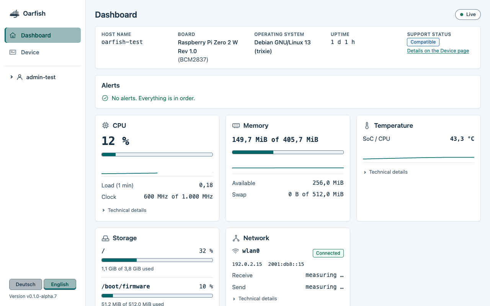
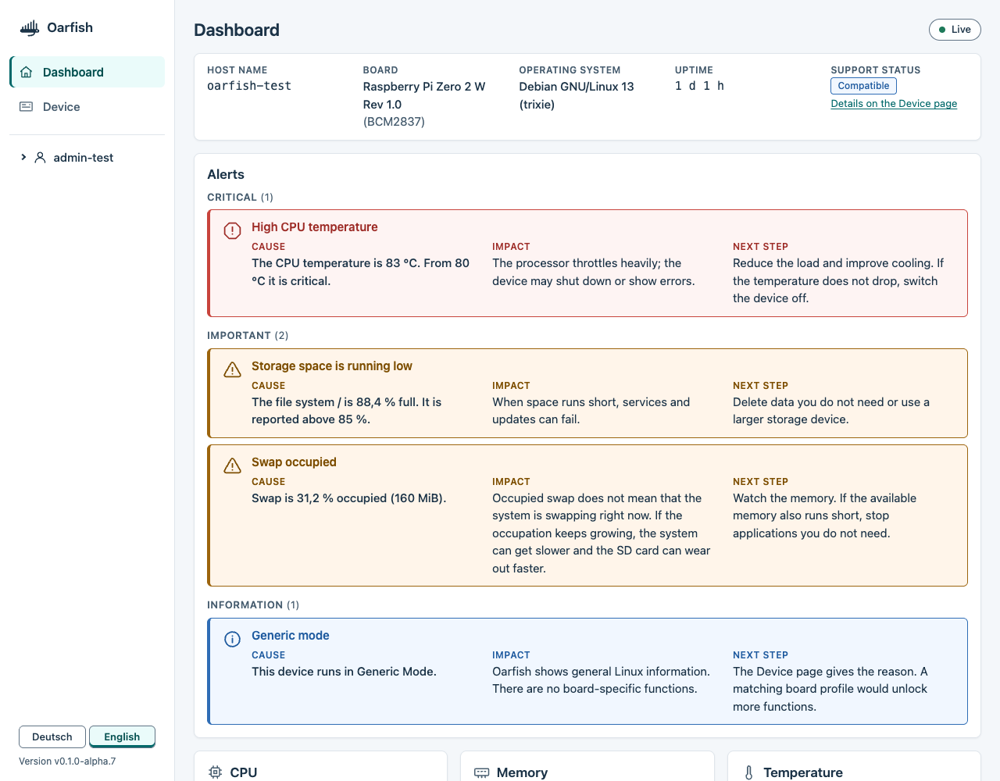
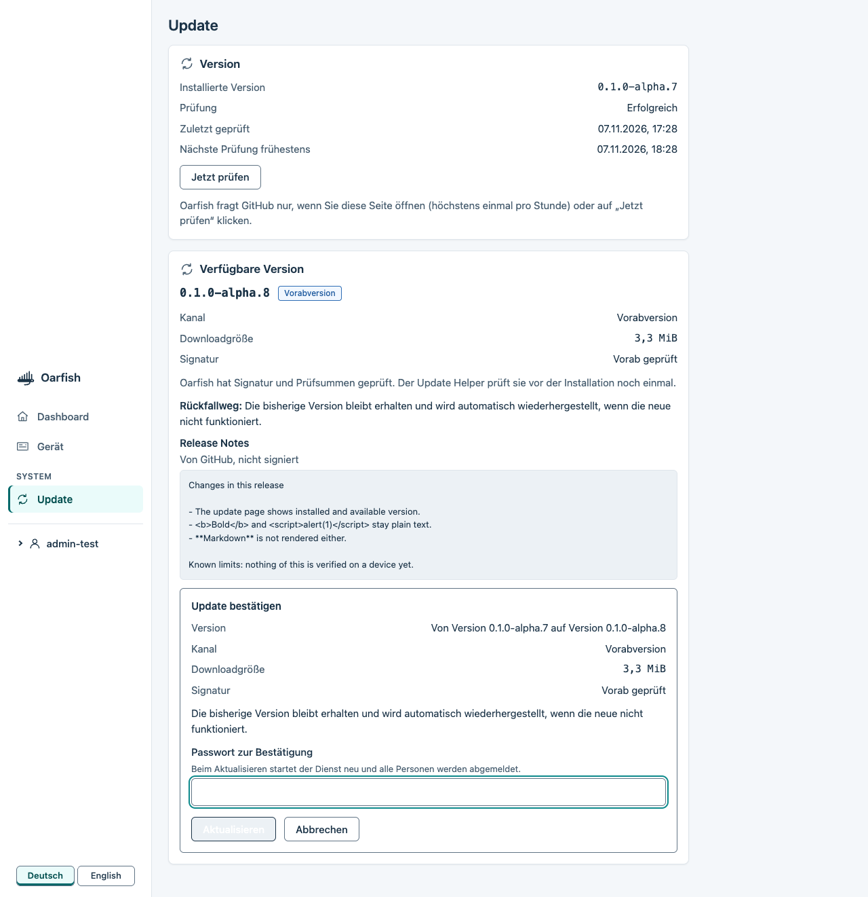

# User interface foundation

Oarfish has one app shell, one set of design tokens, a small set of components, designed states, and the pages built on them, in a light and a dark theme: Dashboard and Gerät (UI foundation task, D-C42, D-C43; the first page was called Home until the shell of task U1, D-C71), since Gate G5.1 the access pages Einrichten (setup), Anmelden (login) and Konto (account), described in [`AUTH.md`](AUTH.md) and in [Access states](#access-states-gate-g51) below, and since step G6.8 the page Update, described in [Update page](#update-page-step-g68) below. The normative sources are specification 7 (GUI principles), ORB-GEN-003 (progressive disclosure), ORB-GEN-006 (texts from translation resources), ORB-NFR-006 (bundle size), ORB-NFR-011 (keyboard, WCAG 2.2 AA) and ORB-NFR-012 (browsers). The Dashboard itself is described in [`DASHBOARD.md`](DASHBOARD.md#dashboard-page).

**Status: implemented and tested** with jsdom unit tests and with headless Chrome on one developer Mac (layout checks at five widths, reference screenshots). **Checked once on a Raspberry Pi Zero 2 W with `v0.1.0-alpha.5`** in Safari, Chrome and Firefox ([hardware result](INSTALL.md#ui-foundation-v010-alpha5)). The shell of task U1 (navigation groups, language choice, version line, tokens) was checked in Chrome on one Mac only. The Update page of step G6.8 was checked in Chrome on one Mac against the development scenario mode only; it has not run against a real update service or device. The second confirmation and the texts of G6.10 step c were checked in jsdom and, for layout only, in headless Chrome on one Mac against the scenario mode. **Not verified:** a screen reader, keyboard use in Safari, forced-colours mode in a real browser, the lost-connection display on the device, the U1 shell on the device and in Safari and Firefox, and the Update page against a device. See [Verification status](#verification-status) and [Known gaps](#known-gaps).

The tokens in this file are named and explicit on purpose. They are meant to be carried into a design tool and back. The source of truth is [`frontend/src/styles/tokens.css`](../frontend/src/styles/tokens.css); `tokens.test.ts` fails when a token this file lists is missing there, and `docs.test.ts` fails when this file lacks a token, a component or a text that the code has.

## Contents

1. [Code layout](#code-layout)
2. [Design tokens](#design-tokens)
3. [Components](#components)
   - [Shell, navigation and language](#shell-navigation-and-language-task-u1)
4. [Layout rules and breakpoints](#layout-rules-and-breakpoints)
5. [States](#states)
   - [Access states](#access-states-gate-g51)
   - [Update page](#update-page-step-g68)
6. [State and label texts](#state-and-label-texts)
7. [Text rules](#text-rules)
8. [Accessibility](#accessibility)
9. [Data-driven rendering](#data-driven-rendering)
10. [Add a page](#add-a-page)
11. [Add a card](#add-a-card)
12. [Reference screenshots](#reference-screenshots)
13. [Size and performance](#size-and-performance)
14. [Verification status](#verification-status)
15. [Known gaps](#known-gaps)

## Code layout

```text
frontend/src/
  main.ts                  mounts App, imports the two style files
  App.svelte               router (hash) and AppShell
  routes.ts                the list of pages: the only place that knows them
  styles/tokens.css        every colour, space, size and duration (both themes)
  styles/base.css          element defaults, focus ring, utilities, forced colours, reduced motion
  styles/contrast-pairs.ts every text and graphic colour pair with its WCAG minimum
  components/              the reusable components (below)
  pages/Dashboard.svelte        Dashboard, built on the components
  pages/Device.svelte      Gerät, built on the components
  pages/Setup.svelte       Einrichten: first start with the setup token (G5.1)
  pages/Login.svelte       Anmelden (G5.1)
  pages/Account.svelte     Konto: change the password (G5.1), reached from the user menu
  pages/Update.svelte      Update: versions, check, apply, progress and result (G6.8)
  lib/session.ts           the session client; the CSRF token lives in its module variable only
  lib/authErrors.ts        error codes of the access endpoints to sentences
  lib/update.ts            client of the update routes, with run-time shape checks of every answer (G6.8)
  lib/updateErrors.ts      error codes of the update routes to sentences (G6.8)
  lib/update.fixtures.ts   one synthetic State per state of the Update page, for tests and the scenario mode
  dev/updateMock.ts        development scenario mode (?mock=<scenario>); never in a production build
  lib/ui.ts                tones, navigation entry and group types, and how API values map to them
  lib/lang.svelte.ts       the chosen language, its browser store, html lang (D-C77)
  lib/version.ts           the version from /healthz for the sidebar footer
  test-setup.ts            tests start as a first visit by a German browser with an empty store
  lib/icons.ts             the own icon set (inline SVG paths)
  lib/contrast.ts          WCAG contrast maths in plain TypeScript
  lib/i18n.ts              t, msg and fmt: texts in the chosen language
  lib/locales/de.ts, en.ts the texts, in two named groups
```

Production code contains no interface, port, hardware address or board name (D-C43); a test scans for them.

## Design tokens

All values are CSS custom properties on `:root` in `tokens.css`. The light set is the default. The dark set replaces only colours and shadows and follows `prefers-color-scheme: dark`. There is no theme switch and no setting. `color-scheme: light dark` is set, so scrollbars and form controls follow the active theme. Under `forced-colors: active` the system colours decide; borders, outlines and shapes carry the meaning (`base.css` and the components).

Colour roles:

- **Surfaces.** `page` is the grey background, `surface` is a card, `surface-muted` is a track or a hover; in the dark theme it has the colour of `page` (owner baseline U0), so a track or a hover reads as a recess in a card.
- **Text.** `text`, `text-secondary` and `text-disabled`. All three pass 4.5:1 on every surface. Disabled text is exempt from WCAG, but is held to the same minimum anyway, is derived from `text-secondary` toward the surface (about 1.5:1 weaker in the light theme), differs from `border`, and is never the only cue: a disabled control is a native `disabled` element and the pointer is `not-allowed`. `tokens.test.ts` checks these rules.
- **Borders.** `border` separates parts and is decorative. `border-strong` outlines a part that must be seen (meter, button, indicator) and passes 3:1.
- **Accent.** One colour, `accent`, for links, the current navigation entry, sparklines and normal meter fills. It is not a status.
- **Semantic roles.** `success`, `information`, `warning`, `critical`, each with `-bg`, `-fg` and `-border`. Warning and critical are reserved for real alerts and real problems (an alert, a lost connection, an unsupported device). `neutral` is not a status: it is for "no link", "unknown" and "not available".
- **Focus.** `focus-ring`, 2 px with a 2 px offset, on every focusable element.

Breakpoint (media queries cannot read custom properties): the shell changes from sidebar to top bar **below 60rem** (960 CSS pixels at the default text size, wider when the text is larger). Nothing else needs a breakpoint: cards, the summary strip, alert columns and key-value rows are intrinsic grids and wrapping rows.

**Colour**

| Token | Light | Dark |
|---|---|---|
| `--color-page` | `#f4f7fa` | `#0f1720` |
| `--color-surface` | `#ffffff` | `#1b3347` |
| `--color-surface-muted` | `#ecf1f5` | `#0f1720` |
| `--color-text` | `#1b3347` | `#ecf1f5` |
| `--color-text-secondary` | `#485e70` | `#adb9c4` |
| `--color-text-disabled` | `#5b6e80` | `#8d9caa` |
| `--color-border` | `#dfe5eb` | `#31485b` |
| `--color-border-strong` | `#617485` | `#8797a6` |
| `--color-accent` | `#006869` | `#68cacb` |
| `--color-accent-fg` | `#ffffff` | `#0f1720` |
| `--color-accent-subtle-bg` | `#eafbfa` | `#013839` |
| `--color-accent-subtle-fg` | `#045050` | `#baf1f0` |
| `--color-focus-ring` | `#0e8a8c` | `#98e4e4` |
| `--color-logo-ink` | `#1b3347` | `#dfe5eb` |
| `--color-success-bg` | `#ebfbf3` | `#003a28` |
| `--color-success-fg` | `#0c6b4d` | `#7ecaa9` |
| `--color-success-border` | `#1f7a5a` | `#52a986` |
| `--color-information-bg` | `#f1f7ff` | `#0b305a` |
| `--color-information-fg` | `#1f5b9f` | `#84bbfe` |
| `--color-information-border` | `#2f6db5` | `#5998e3` |
| `--color-warning-bg` | `#fff5ea` | `#452901` |
| `--color-warning-fg` | `#7e4f02` | `#e5ab66` |
| `--color-warning-border` | `#9c640d` | `#c48737` |
| `--color-critical-bg` | `#fef4f3` | `#581412` |
| `--color-critical-fg` | `#9e2d28` | `#ff968a` |
| `--color-critical-border` | `#c8443c` | `#e7685d` |
| `--color-neutral-bg` | `#ecf1f5` | `#31485b` |
| `--color-neutral-fg` | `#485e70` | `#cdd5dc` |
| `--color-neutral-border` | `#617485` | `#8797a6` |

**Spacing**

| Token | Light | Dark |
|---|---|---|
| `--space-1` | `0.25rem` | same |
| `--space-2` | `0.5rem` | same |
| `--space-3` | `0.75rem` | same |
| `--space-4` | `1rem` | same |
| `--space-5` | `1.5rem` | same |
| `--space-6` | `2rem` | same |
| `--space-7` | `3rem` | same |
| `--space-8` | `4rem` | same |

**Radius**

| Token | Light | Dark |
|---|---|---|
| `--radius-sm` | `4px` | same |
| `--radius-md` | `6px` | same |
| `--radius-lg` | `8px` | same |
| `--radius-full` | `999px` | same |

**Font** (system fonts only: no web font and no download, D-C71. MiB and the German number format stay as the UI already shows them, in both languages.)

| Token | Light | Dark |
|---|---|---|
| `--font-sans` | `system-ui, -apple-system, 'Segoe UI', Roboto, 'Helvetica Neue', Arial, sans-serif` | same |
| `--font-mono` | `ui-monospace, 'SF Mono', SFMono-Regular, Menlo, Consolas, 'Liberation Mono', monospace` | same |

**Text size**

| Token | Light | Dark |
|---|---|---|
| `--text-xs` | `0.75rem` | same |
| `--text-sm` | `0.8125rem` | same |
| `--text-md` | `0.9375rem` | same |
| `--text-lg` | `1.0625rem` | same |
| `--text-xl` | `1.375rem` | same |
| `--text-2xl` | `1.875rem` | same |

**Weight**

| Token | Light | Dark |
|---|---|---|
| `--weight-regular` | `400` | same |
| `--weight-medium` | `500` | same |
| `--weight-semibold` | `600` | same |

**Line height**

| Token | Light | Dark |
|---|---|---|
| `--leading-tight` | `1.2` | same |
| `--leading-snug` | `1.35` | same |
| `--leading-normal` | `1.5` | same |

**Elevation**

| Token | Light | Dark |
|---|---|---|
| `--shadow-card` | `0 1px 2px 0 rgb(16 24 32 / 0.06)` | `0 1px 2px 0 rgb(0 0 0 / 0.4)` |
| `--shadow-raised` | `0 4px 12px 0 rgb(16 24 32 / 0.1)` | `0 4px 12px 0 rgb(0 0 0 / 0.5)` |

**Focus**

| Token | Light | Dark |
|---|---|---|
| `--focus-ring-width` | `2px` | same |
| `--focus-ring-offset` | `2px` | same |

**Motion**

| Token | Light | Dark |
|---|---|---|
| `--duration-fast` | `120ms` | same |
| `--duration-base` | `200ms` | same |
| `--ease-standard` | `cubic-bezier(0.2, 0, 0, 1)` | same |

**State**

| Token | Light | Dark |
|---|---|---|
| `--opacity-stale` | `0.85` | same |

**Layout**

| Token | Light | Dark |
|---|---|---|
| `--sidebar-width` | `14rem` | same |
| `--content-max` | `80rem` | same |
| `--target-min` | `1.5rem` | same |

## Components

All components are Svelte 5 with TypeScript and no dependency. They hold no UI text; texts come from `lib/locales`. Interactive elements are always native (`a`, `button`, `summary`).

| Component | Purpose | Props | States and behaviour |
|---|---|---|---|
| `AppShell` | Skip link, banner with brand, navigation in groups, the user menu and a footer (language switch, version line), main area. Below 60rem the sidebar is a top bar. | `items` (navigation entries, each with an optional `group`), `current` (id), `account` (the user menu), `children` | Current entry has `aria-current="page"`, a tint and a bar, so it is not shown by colour alone. The skip link moves focus to `main` and never changes the address. A group with no entry is not shown. |
| `AuthShell` | The frame before sign-in (checking, setup, login): brand bar and one narrow column in `main`. No navigation, no device data. | `children` | One `main` landmark; the page inside has the `h1`. |
| `BrandMark` | The Oarfish mark in the sidebar header, decorative. It draws the paths of the owner's mark, `frontend/src/assets/oarfish-mark-mono.svg`, in a single colour: `currentColor`, set to `--color-logo-ink`. A test compares the paths with the file. The favicon is not changed. | none | `aria-hidden`; the brand name next to it is the text. |
| `LanguageSwitch` | Two buttons, Deutsch and English, in the sidebar footer. | none | A `group` named "Sprache" or "Language"; the chosen button has `aria-pressed="true"` and a bar, so it is not shown by colour alone. Each button names its language in that language (`lang` attribute). Native buttons: Tab, Enter and Space. |
| `VersionLine` | The Oarfish version in the sidebar footer, from `/healthz`. | none | Shows nothing while the request runs and nothing when it fails or answers something that is not a version: no error banner. Not a live region. |
| `UserMenu` | The signed-in user in the shell: a native `details` whose `summary` is the user name; inside, the link to Konto and the Abmelden button. | `username`, `accountHref`, `current`, `onLogout`, `busy` | The summary's accessible name is "Benutzermenü: <name>". Opened with Enter or Space. Not a live region. |
| `FormField` | Label, optional help, input and the field's own error, tied together with `for`, `aria-describedby` and `aria-invalid`. | `id`, `label`, `value` (bindable), `type` (`text`, `password`), `autocomplete`, `help`, `error`, `disabled`, `input` (bindable element) | Always `autocapitalize="off"` and `spellcheck="false"`. An error adds a 2 px critical border and the error text below the field, never colour alone. |
| `FormMessage` | The message area of a form. | `tone`, `testid` | `role="alert"` for `critical` (announced at once), `role="status"` otherwise. A new error is a new node, so the same sentence is announced again. |
| `PageHeader` | The one `h1` of a page and an optional small aside. | `title`, `aside` | Wraps on a narrow screen. |
| `Card` | A labelled section with a heading (`<id>-heading`), an icon and a body. | `id`, `title`, `icon`, `stale`, `wide` | `stale`: the body is dimmed to `--opacity-stale` (contrast is tested at that opacity, including the tinted alerts) and the header shows the Veraltet badge. Every card of Dashboard, the alerts card included, uses it. |
| `SummaryStrip` | The row at the top of the Dashboard: host name, board, operating system, uptime, support status. A group, not a section. | `items`, `label`, `stale` | The host name is cut to one line with the full text as `title`; other values wrap. A missing value is a neutral placeholder. |
| `Badge` | A short status word. | `tone` (`neutral`, `success`, `information`, `warning`, `critical`), `icon` | The text is the meaning; the icon and colour only support it. |
| `Notice` | A sentence or two that explains a state, with an icon. Not a live region. | `tone` | Used for the lost-connection explanation and the support explanation. |
| `AlertList` | The alerts, grouped by level with a count per level. The only live region (`aria-live="polite"`). | `alerts`, `stale` | No alerts: one calm line. With `stale` the line says what was true at the last reading, in secondary text with a neutral clock icon instead of the green check. |
| `AlertItem` | One alert: level icon, short title (if the rule has one), then cause, impact and next step in columns. | `alert` | Columns stack on a narrow card. The level is told by icon shape, heading text and colour. |
| `Meter` | A usage bar. A native `progress` element with an accessible name. | `value`, `label`, `level` (`ok`, `relevant`, `critical`) | `ok` is the accent; the other two use warning and critical, like the storage alerts. The fill does not animate. |
| `Sparkline` | A small inline-SVG line of the last minutes. | `values`, `min`, `max`, `label` | An image with a text alternative. Fewer than two values: the text "Noch kein Verlauf". It is redrawn only when new data arrives. |
| `KeyValueList` | Label and value pairs as a definition list. | `items` (`label`, `value`, `note`, `mono`, `placeholder`, `title`, `testid`) | Never collapses (see [Layout rules](#layout-rules-and-breakpoints)). `null` shows a neutral placeholder. |
| `ConnectionIndicator` | A small pill at the top right of Dashboard. | `state` | `live`, `connecting`, `reconnecting`, `stale`, `paused`, each with its own text. Not a live region. |
| `EmptyState` | A state without data: loading, error, or "nothing found". | `icon`, `tone`, `title`, `description`, `compact`, `role` | Full size on a page, `compact` inside a card. Only an error state gets `role="alert"`. |
| `Icon` | One of the own icons, decorative (`aria-hidden`). | `name` | Sizes with the text (`1.25em`), colour is `currentColor`. |

Icons: `home`, `device`, `chip`, `memory`, `thermometer`, `drive`, `network`, `wifi`, `ethernet`, `info`, `warning`, `critical`, `success`, `clock`, `user`, `lock`, `update` (two arrows in a circle, for the Update entry and its cards, G6.8). They are 24 by 24 outline paths drawn for this project, so there is no icon library and no third-party licence. The icon for an interface follows the API field `kind` (`wifi`, `ethernet`, else the generic `network`).

### Shell, navigation and language (task U1)

**Navigation (specification 7.2, D-C71).** The first entry is "Dashboard" (it was "Home"; the address `#/` did not change). Entries without a group come first, then the group "Workload" (Apps, Storage, Files), then "System" (Network, Activity, Update, Erweiterungen, Settings). An entry exists only when its function exists (specification 7.1). Today there are three entries: Dashboard (`#/`, `pages/Dashboard.svelte`) and Gerät (`#/device`, `pages/Device.svelte`) without a group, and Update (`#/update`, `pages/Update.svelte`, step G6.8) as the first entry of the group System, which therefore appears for the first time. The account page `#/account` is reached from the user menu and is not an entry. A page that comes later sets `group: 'workload'` or `group: 'system'` in `routes.ts`; the group name appears with its first entry.

**Language (ORB-GEN-006, D-C77).** German and English have the same keys; a test proves it. The start language follows the first language of `navigator.languages` that is German or English; anything else is English. The Deutsch and English buttons in the sidebar footer change the language at once, without a reload, and set `html lang`. The choice is kept in `localStorage` under the key `oarfish.lang`; only the code `de` or `en` is stored, and any other stored value is ignored. A store that cannot be read or written (private window, blocked site data) does not break the app: it starts from the browser language and does not remember. Components read `t`, `msg` and `fmt` from `lib/i18n.ts` where they show them, so a change reaches the whole page. Numbers keep the German format and units stay binary (MiB) in both languages. The language is not yet a setting: the settings page and a server-side store come later (H1).

**Version line.** The sidebar footer shows "Version <version>" from the `version` member of `/healthz` (a public route). The value is shown only if it consists of letters, digits and `. _ + -` (at most 64 characters). The shell calls no update route. Only the Update page uses the update routes; the update notice route stays unused until a user-visible off switch exists (ADR 0010, A11.1, D-C68), and `shell.test.ts` fails if a frontend source names it (until G6.8 the test refused every `/api/v1/update` name).

**Sidebar footer.** Below 60rem it sits at the right of the top bar, the language switch above the version line, so that at 390 CSS pixels the bar has two rows (brand and entries, then user menu and footer) instead of three.

## Layout rules and breakpoints

- **Shell.** At 60rem and wider: a 14rem sidebar (brand, navigation in groups, user menu, and the footer with language switch and version line at its bottom) and the content area, which starts next to the sidebar and is at most 80rem wide (`--content-max`). Below 60rem: a top bar with the brand and the navigation entries in a row that wraps, and the content below. The top bar scrolls away; nothing is `sticky` in the narrow layout, so a focused element is never hidden behind it (WCAG 2.4.11). The wide sidebar does not overlap content.
- **Wide windows.** The content sits next to the sidebar and is not centred. Navigation and page belong together, so a fixed 24 px gap keeps the eye path short at every width, and the unused space collects at the right window edge where nothing is missed. The maximum width keeps the cards and the text lines readable. Checked in headless Chrome at 360, 1280, 1920 and 2560 CSS pixels in light and dark (gap between sidebar and content 24 px from 1280 px up, before: 208 px at 1920 and 528 px at 2560; no horizontal scroll). Screenshots: [`design/known-gaps/`](design/known-gaps/). `components.test.ts` "AppShell layout rule" pins the rule in the source.
- **Cards.** An intrinsic grid: as many columns as fit, each at least 20rem (or the whole width when that is less). A wide card spans the row. No other breakpoint.
- **Label and value.** `KeyValueList` is a wrapping row, not a grid with fixed columns. Label and value sit side by side when they fit; when they do not, the value moves below the label. Neither is ever squeezed into a thin column. Long words break (`overflow-wrap: anywhere`) rather than overflow.
- **Grids inside grids** always declare `minmax(0, 1fr)` tracks, so a long unbreakable name can never widen a card.
- **Long names** (host name, interface, mount point, sensor) are one line with an ellipsis and the full text in `title`. Everything else wraps.
- **Units** are binary (`KiB`, `MiB`, `GiB`), never `MB` or `GB`. Numbers use the monospace face with tabular figures (`.num`).
- **Text size** is in `rem`, so the page follows the browser's text size. Nothing has a fixed height.

Checked at 320, 390, 768, 1280 and 1920 CSS pixels with a headless Chrome script (not part of the repository), for Dashboard with a normal device, a device with the largest lists (8 interfaces, 8 mounts, 16 sensors, very long names, an unknown interface kind), a device with unknown values, Generic Mode, a lost connection and the Gerät page; and again at 320, 390 and 1280 with WCAG 1.4.12 text spacing (line height 1.5, letter spacing 0.12em, word spacing 0.16em, paragraph spacing 2em) and with the text size at 200 percent. Result: no horizontal scroll, no element outside the window, no clipped text, no label or value collapsed into a column narrower than 4rem, no interactive element smaller than 24 by 24 CSS pixels (links inside running text excepted). 320 CSS pixels is 400 percent zoom on a 1280 pixel window (WCAG 1.4.10).

## States

Each state is designed and has a test (`pages/Dashboard.states.test.ts`, `pages/Dashboard.test.ts`, `pages/Device.test.ts`).

| State | What the user sees | Test |
|---|---|---|
| Loading (first paint) | Page header, an `EmptyState` with "Werte werden geladen …", the indicator "Verbindet …". | `Dashboard.states.test.ts` "state loading" |
| Live | Indicator "Live", values in place, no notice, no Veraltet. | "state live" |
| Connection lost | The last values stay, dimmed; every card (the alerts card too) and the strip say "Veraltet"; a notice says what happened and when the last update was. | "state connection lost", "gap 1" tests |
| Reconnecting | Indicator "Verbindet neu …". Without any data yet the page says "Verbindung wird aufgebaut …". Network rates show the last value (dimmed) or "Nicht verfügbar", never "wird ermittelt …". | "state reconnecting", "state reconnecting without data" |
| Open but silent | Indicator "Keine neuen Werte" and a notice, after 7 seconds without a value. | "state open but silent" |
| Paused | Indicator "Pausiert" (the tab was hidden; no stream is open). | "state paused" |
| Tab shown again | The old values are marked "Veraltet" (every card, the alerts card, the strip) from the first frame on, with the indicator "Verbindet …" and no lost-connection notice, until the first new value arrives. The alert list then says only what was true at the last reading. | "gap 2" tests |
| Load error | `EmptyState` with the error, a hint and a retry button. | "state load error" |
| No alerts | One calm line inside the live region. While live it says "Keine Hinweise. Alles in Ordnung." with the green check icon. While the values are stale, the connection is lost or reconnecting, or the stream has not delivered a value since the tab was shown, it says only "Beim letzten Abruf gab es keine Hinweise." with a neutral clock icon in secondary text. | "state no alerts", "empty alert list", "gap 3" in `Dashboard.states.test.ts` |
| One alert per level | Three groups with counts; each alert with icon, short title, cause, impact and next step. | "state one alert per level" |
| No sensors, no storage, no interfaces | One plain line in the card. | "state no sensors, no storage, no interfaces" |
| Unknown values | A neutral placeholder ("Unbekannt", "Nicht verfügbar"), never an empty field, `null` or `NaN`. | "state unknown values" |
| Generic Mode | Neutral status badge, the informational alert, no board claim. | "state Generic Mode" |
| Very long host name | One line, ellipsis, full name as `title`. | "state very long host name" |
| Link states | `up` is a green "Verbunden". "Kein Link", "Unbekannt" and any state this version does not know are neutral grey, never a warning. | "shows a link state honestly" |
| Support tier | `verified` success, `compatible` information, `experimental` warning, `unsupported` critical, everything else neutral. | "colours the support status by tier" |

### Access states (Gate G5.1)

The app shows nothing of the dashboard until `GET /api/v1/session` has answered (ADR 0009). Tests: `pages/Auth.test.ts`, `lib/session.test.ts`, `App.test.ts`.

| State | What the user sees | Test |
|---|---|---|
| Checking the session | `AuthShell` with "Sitzung wird geprüft …"; no navigation, no request for device data, no stream. | `Auth.test.ts` "shows nothing of the dashboard before the session state is known" |
| Oarfish unreachable | "Oarfish ist nicht erreichbar." with the hint and "Erneut versuchen". | "says so when Oarfish cannot be reached, and tries again" |
| Setup required | Einrichten: setup code with the command `sudo cat /var/lib/oarfish/setup-token`, user name, password twice; a read-only section "Erreichbarkeit" says that Oarfish is reachable on this device only (loopback). There is no binding choice. Focus starts on the first field. | "names the command for the token, says that Oarfish listens on this device only, and has accessible fields" |
| Setup rule broken | The broken rule in the message area and at the field, the field marked invalid and focused, both password fields cleared. Nothing is sent. | "checks the rules before sending and names the broken one" |
| Setup token wrong | "Der Einrichtungscode stimmt nicht. …", focus on the setup code. | "shows the server answer for a wrong token, then sets up and opens the app" |
| Login | Anmelden: user name (`autocomplete="username"`), password (`current-password`); focus on the user name. | "has labelled fields with the right autocomplete and the focus on the user name" |
| Login failed | One sentence for a wrong user name and a wrong password; the password is cleared, the user name kept, focus on the password. | "gives the same sentence for a wrong user name and a wrong password, and clears the password" |
| Rate limited | "Zu viele Versuche. Warten Sie 8 Sekunden …" ("eine Sekunde" for one, minutes from two minutes on). | "shows the wait time when rate limited" |
| Session ended | Back on Anmelden with "Die Sitzung ist beendet. Melden Sie sich erneut an." after any 401, after the stream's last `session` event, or when a refused stream finds the session gone. The stream is closed and not reopened. | "returns to the login page with "session ended" on a 401, without a reconnect loop", "returns to the login page when the server ends the stream with the session event", "asks for the session before reconnecting a refused stream, and stops when it is gone" |
| Signed out | Back on Anmelden with "Sie sind abgemeldet."; the stream is closed. | "has a user menu with the account page and Abmelden, and logs out" |
| Account | Konto: "Angemeldet als …", the session lifetimes, the form current / new / repeat. Errors as above; success: "Das Passwort ist geändert. Alle anderen Sitzungen sind beendet." | "changes the password on the account page" |
| No secret in the browser | The CSRF token is in a module variable; neither it nor a password is in `localStorage`, `sessionStorage`, `document.cookie`, the address, the title or the page. | "signs in, keeps the token out of browser storage and the address, and sends no CSRF-free change", `session.test.ts` "reads the session state and keeps the CSRF token in memory only" |

Where stale values could read as a current claim (checked for the wording fix; only wording and marking were changed):

| Place | While stale, lost or reconnecting | Result |
|---|---|---|
| Empty alert list | "Beim letzten Abruf gab es keine Hinweise." | Fixed |
| Network rates | Last rate, dimmed with the card, or "Nicht verfügbar"; "wird ermittelt …" only while live | Fixed |
| Link badge "Verbunden" and addresses | Inside a dimmed card that says "Veraltet" | Marked by the card, unchanged |
| Meters, values, sparklines | Same, and the sparkline text says "zuletzt" | Marked by the card, unchanged |
| Summary strip | Dimmed, "Veraltet" badge | Marked, unchanged |
| Alerts that exist | Shown as they were at the last reading, in the alerts card, which is dimmed and marked Veraltet like the others | Fixed (known-gaps task) |
| Tab shown again after a pause | Old values are marked Veraltet from the first frame until the first new value arrives | Fixed (known-gaps task) |
| No-alerts icon | Neutral clock instead of the green check while stale | Fixed (known-gaps task) |

The alert rules themselves (including the rule "no interface has a link") are unchanged and described in [`DASHBOARD.md`](DASHBOARD.md#alerts). The UI shows no alert for a single interface without a link.

### Update page (step G6.8)

`pages/Update.svelte` on `#/update`, the first entry of the group System (specification 7.2 and 9.5; ADR 0010 U3, U9, A11 and A12). It reads `GET /api/v1/update` and sends `POST /api/v1/update/check`, `/apply` and `/discard` through `lib/update.ts`, with the CSRF token of `lib/session.ts` (`postJSON`). It never calls the notice route of A11.1 (D-C68). Rules:

- **Checks.** On opening, the page sends `POST check {}` only when the State says `check.state` is `never` or `next_check_at` has passed; otherwise it only reads. "Jetzt prüfen" sends `{"force":true}` and is then disabled for 60 seconds with a visible countdown ("Eine neue Prüfung ist in 42 Sekunden möglich."). A `rate_limited` or `cooldown` answer, and a `rate_limited` check error in the State with `retry_after_seconds`, lock it for that long; `check.throttled` is said in words. The countdown is a one-second interval that exists only while the button is locked and sends nothing. No timer runs while the page is closed.
- **Polling.** `GET /api/v1/update` every 2 seconds, only while `job.running` is true or while the page waits for the restart after `activating`; the component's cleanup stops it when the page is left.
- **Restart.** When reads fail during or after `activating`, the live region says "Der Dienst startet neu. Danach melden Sie sich erneut an." (before `activating` it says only "Oarfish antwortet gerade nicht. Die Seite fragt alle zwei Sekunden erneut.") and the page keeps reading every 2 seconds for at most 3 minutes; then it says "Der Dienst hat drei Minuten lang nicht geantwortet. Öffnen Sie die Seite später erneut." with "Erneut laden". A 401 takes the existing session-loss path to Anmelden; after signing in, the address `#/update` shows the page again with `last_result`. The page shows what the State says and claims nothing else about the process or its health.
- **Confirmation.** An inline panel below the available version, not a modal dialog: from and to version, channel, size, signature status, the rollback sentence, and the password field (`autocomplete="current-password"`; its help text says that the service restarts and everybody is signed out). The focus moves into the field on opening and back to "Aktualisieren" on closing; Escape and "Abbrechen" close it. The password is only in the input and in the request, and the input is cleared after every attempt.
- **Untrusted text.** Release notes, versions, component names and codes from the API are text nodes only. The notes are one text node in a box with `white-space: pre-wrap`, at most 20rem high and scrollable, labelled "Von GitHub, nicht signiert". The server's English messages and the installer instruction of the service are never shown: every code has its own sentence (`lib/updateErrors.ts`), `http_<three digits>` shares one, and an unknown code gets "Das hat nicht funktioniert. Versuchen Sie es erneut."
- **Shape checks.** `lib/update.ts` checks every answer at run time. A wrong structure, a step outside the closed set of the service or another schema version is a load error. A helper phase or a result outcome that this version does not know is kept and shown neutrally ("Unbekannt").

| State | What the user sees | Test (`pages/Update.test.ts`) |
|---|---|---|
| Loading | "Update-Zustand wird geladen …" as a status. | "state loading" |
| Load failed | "Der Update-Zustand konnte nicht geladen werden." with the hint and "Erneut versuchen"; an answer of an unknown shape is the same error. | "state load failed" (two tests) |
| Helper not present | A warning notice: the update function needs the update helper of the installation, the installation guide, and the sentence of the helper's error code. No "Aktualisieren"; "Jetzt prüfen" works. | "state helper not present" |
| Never checked | "Es ist noch nicht geprüft worden."; the page sends one check on opening. | "state never checked" |
| Up to date | Installed version, "Erfolgreich", both times, and "Dieses Gerät war bei der letzten Prüfung auf dem neuesten Stand." | "state up to date" |
| Update available | Version, channel badge (with text), download size, "Vorab geprüft" with the sentence that the update helper checks again, the rollback sentence, the release notes, "Aktualisieren". | "state update available (verified)", "… stable and without notes" |
| Not verified | "Nicht bestätigt", the sentence of `verify_error` and "Diese Version wird nicht angeboten."; no button. | "state update available but not verified" |
| Check running | "Wird geprüft …" as a status, "Jetzt prüfen" disabled, reading every 2 seconds until the job ends. | "state check running" |
| Check failed | "Die Prüfung ist fehlgeschlagen." with the sentence of the code (for `tls_failure`: check date and time of the device), the retry hint from `retry_after_seconds`, and `next_check_at`. | "state check failed", "state check rate limited" |
| Throttled | "Es wurde gerade erst geprüft. Sie sehen das Ergebnis der letzten Prüfung." | "state throttled" |
| Apply running | The steps as an ordered list; the current one has `aria-current="step"` and "läuft …", the others "erledigt" or "ausstehend"; a polite live region "Aktueller Schritt: …". No spinner. | "state apply running" |
| Awaiting components confirmation (G6.10 step c) | The card "Neue Bestandteile bestätigen": "Diese Version ersetzt auch privilegierte Bestandteile von Oarfish:" and a list of `job.differs`, each in plain words with its file name in `code` ("Update Helper (oarfish-update-helper)", …, "Dienstdefinition von Oarfish (oarfish.service)"; a name this version does not know is shown as the name only); the restart sentence; the failure sentence (with a helper file: the previous version is restored and a new helper that passed its check stays; with `oarfish.service` alone, D6: the previous version is restored with its service definition); when the socket unit is listed, that it takes effect after the next restart of the device (D4); a password field whose help text says that the password is asked once more (D7); "Bestätigen und aktualisieren" and "Verwerfen". When the staged release expires meanwhile, the card goes and the failed job says to check again and start once more. | "state awaiting components confirmation …", "the second confirmation names every staged component in plain words (de)" and "(en)", "oarfish.service alone (D6) …", "a name this version does not know …", "\"Verwerfen\" in the second confirmation …", "the staged release expires while the dialog waits …", "the second confirmation sends …" |
| Components being replaced (F4) | While the page watches an update whose helper is in a component phase, or which the service reports as `handing_over` (the helper between its two processes, at most 60 s, ADR 0010 A17), the live region of the progress card says "Die Bestandteile des Update Helpers werden ersetzt. Er startet dabei kurz neu."; the warning "helper not present" is not shown then. Without `handing_over` the warning comes back. | "F4: a component phase …", "F4: an unreachable helper inside the bound …", "F4: past the bound …", "F4: the course after the second confirmation …" |
| Installer required (F1) | A warning notice: "Installer nötig. Diese Version lässt sich nicht von dieser Seite aus installieren." and a reason sentence of the code (`installer_required`, `key_changed`, `unit_rejected`, `requirements_not_met`; without a code: `installer_required`); then download `install.sh` from the release page of the version, read it, run it on the device with sudo (the fixed command `sudo sh install.sh`); settings and account are kept; the installation guide; for `installer_required` the differing component names. No button. | "state installer required", "F1, <code>: …" (four tests), "F1: an installer view without a code …" |
| Apply failed before activation | "Das Update auf Version … wurde nicht ausgeführt." with the sentence of the code. | "state apply failed before activation" |
| Finished | A badge in words (Erfolgreich, Zurückgerollt, Bestandteile zurückgerollt, Wiederherstellung fehlgeschlagen, Abgebrochen; an unknown outcome reads "Unbekannt"), a sentence with both versions, the finish time, and the reason code under "Technische Einzelheiten". Since G6.10 step c: with `components_updated` one more sentence (success: the helper and its units were replaced as well; rolled back or aborted, F31: the new helper passed its check and stays); `components_rolled_back` with one sentence per reason group (the new helper failed its check: `helper_mismatch`, `key_changed`, `protocol_mismatch`; interrupted: `interrupted`; the state could not be read: `state_unreadable`; a step of the switch failed: `switch_failed`, `state_write_failed`, `reload_failed`; an unknown reason gets none); `rollback_failed` with `known_good_damaged`: its own sentence and that a person with a shell is needed, naming INSTALL.md; `aborted` with `state_rebuilt` (no versions, F3): its own sentence. | "state finished, …" (five tests), "… with an outcome this version does not know", "success with components_updated …", "F31: …", "aborted with components_updated …", "components_rolled_back, <reason>: …" (eight tests), "… a reason this version does not know …", "rollback_failed with known_good_damaged …", "F3: a rebuilt state …" |
| Socket unit pending (D4) | An information notice "Die neue Socket-Unit des Update Helpers wird erst nach dem nächsten Neustart des Geräts wirksam." while `helper.socket_restart_pending` is true. | "success with components_updated …" |
| Cooldown | "Version … ist vor Kurzem zurückgerollt worden. Ein neuer Versuch ist in … möglich."; no button for that version. | "state cooldown" |
| Helper needs attention | A critical notice with the next step (run the installer again, as the installation guide describes). | "state helper needs attention" |
| Staged release waiting | "Version … ist vorbereitet und wartet. …" with "Verwerfen"; no "Aktualisieren" while it waits (the helper would answer `busy`). | "state staged release waiting" |
| Restarting, and no answer for 3 minutes | See "Restart" above. | the tests under "restart" |

**Accessibility of the second confirmation (G6.10 step c).** The component names are a native list (`ul`), each file name a `code` element; the password field has a visible label and its help text is tied with `aria-describedby`; the two buttons are native `button` elements; nothing carries meaning by colour alone (the hand-over is said in the live region, the outcome badge is a word). The F4 text is spoken by the existing polite live region; no new live region was added. Checked in jsdom; not with a screen reader.

Every fixture state also renders without a load error ("every state of the fixtures renders …"). The development scenario mode shows each of them in a browser ([`DEVELOPMENT.md`](DEVELOPMENT.md#update-page-and-its-scenario-mode-gate-g6-step-g68)).

## State and label texts

All texts the interface says about itself are in one group, `deUi` in [`frontend/src/lib/locales/de.ts`](../frontend/src/lib/locales/de.ts), with the same keys as `enUi` in `en.ts`. Lift this group in one piece. The sentences the API selects by key (alerts, support explanations, limitations, capabilities, and the short alert titles) are in the second group, `deApi`; they are not listed here. The start language follows the browser (see [Shell, navigation and language](#shell-navigation-and-language-task-u1)); German is the language of the source texts.

| Key | Deutsch | English |
|---|---|---|
| `brandName` | Oarfish | Oarfish |
| `skipLink` | Zum Inhalt springen | Skip to content |
| `navLabel` | Hauptnavigation | Main navigation |
| `navDashboard` | Dashboard | Dashboard |
| `navDevice` | Gerät | Device |
| `navGroupWorkload` | Workload | Workload |
| `navGroupSystem` | System | System |
| `langLabel` | Sprache | Language |
| `langGerman` | Deutsch | Deutsch |
| `langEnglish` | English | English |
| `versionLine` | Version {version} | Version {version} |
| `dashboardTitle` | Dashboard | Dashboard |
| `deviceTitle` | Gerät | Device |
| `connIndicatorLive` | Live | Live |
| `connIndicatorConnecting` | Verbindet … | Connecting … |
| `connIndicatorReconnecting` | Verbindet neu … | Reconnecting … |
| `connIndicatorStale` | Keine neuen Werte | No new values |
| `connIndicatorPaused` | Pausiert | Paused |
| `dashboardLoading` | Werte werden geladen … | Loading values … |
| `dashboardLoadError` | Die Werte konnten nicht geladen werden. | The values could not be loaded. |
| `dashboardLoadErrorHint` | Prüfen Sie, ob Oarfish auf dem Gerät läuft, und versuchen Sie es noch einmal. | Check that Oarfish is running on the device, then try again. |
| `dashboardRetry` | Erneut versuchen | Try again |
| `connConnecting` | Verbindung wird aufgebaut … | Connecting … |
| `connLost` | Die Verbindung ist unterbrochen. Die Werte sind veraltet. Oarfish verbindet sich automatisch neu. | The connection is lost. The values are out of date. Oarfish reconnects by itself. |
| `connStale` | Seit einigen Sekunden kommen keine neuen Werte an. Die Werte sind vielleicht veraltet. | No new values have arrived for a few seconds. The values may be out of date. |
| `connLastUpdate` | Letzte Aktualisierung: {time} | Last update: {time} |
| `staleBadge` | Veraltet | Out of date |
| `unknownValue` | Unbekannt | Unknown |
| `unavailableValue` | Nicht verfügbar | Not available |
| `technicalDetails` | Technische Einzelheiten | Technical details |
| `summaryHeading` | Überblick über das Gerät | Device overview |
| `sumHost` | Hostname | Host name |
| `sumBoard` | Board | Board |
| `sumSoc` | SoC | SoC |
| `sumOs` | Betriebssystem | Operating system |
| `sumUptime` | Laufzeit | Uptime |
| `sumSupport` | Supportstatus | Support status |
| `sumDeviceLink` | Details auf der Seite Gerät | Details on the Device page |
| `uptimeDaysHours` | {days} T {hours} Std. | {days} d {hours} h |
| `uptimeHoursMinutes` | {hours} Std. {minutes} Min. | {hours} h {minutes} min |
| `uptimeMinutes` | {minutes} Min. | {minutes} min |
| `alertsHeading` | Hinweise | Alerts |
| `alertsNone` | Keine Hinweise. Alles in Ordnung. | No alerts. Everything is in order. |
| `alertsNoneStale` | Beim letzten Abruf gab es keine Hinweise. | There were no alerts at the last reading. |
| `alertCause` | Ursache | Cause |
| `alertImpact` | Auswirkung | Impact |
| `alertNext` | Nächster Schritt | Next step |
| `level.critical` | Kritisch | Critical |
| `level.relevant` | Wichtig | Important |
| `level.informational` | Information | Information |
| `cpuHeading` | CPU | CPU |
| `cpuUsage` | Auslastung | Usage |
| `cpuLoad` | Last (1 Min.) | Load (1 min) |
| `cpuFreq` | Takt | Clock |
| `cpuFreqOfMax` | {current} von {max} | {current} of {max} |
| `cpuGovernor` | Governor | Governor |
| `cpuCores` | Kerne | Cores |
| `cpuLoadLong` | Last (5 / 15 Min.) | Load (5 / 15 min) |
| `cpuNoFreq` | Der Kernel meldet keinen Takt. | The kernel reports no clock speed. |
| `memHeading` | Arbeitsspeicher | Memory |
| `memUsed` | Belegt | In use |
| `memAvailable` | Verfügbar | Available |
| `memTotal` | Gesamt | Total |
| `memSwap` | Auslagerungsspeicher (Swap) | Swap |
| `memSwapNone` | Kein Swap eingerichtet | No swap configured |
| `memUsedOf` | {used} von {total} | {used} of {total} |
| `tempHeading` | Temperatur | Temperature |
| `tempNone` | Keine Temperatursensoren gefunden. | No temperature sensors found. |
| `tempSoc` | SoC / CPU | SoC / CPU |
| `tempSource` | Quelle | Source |
| `tempSensorId` | Sensor | Sensor |
| `tempSource.thermal_zone` | Thermal Zone | Thermal zone |
| `tempSource.hwmon` | Hardware-Monitor | Hardware monitor |
| `storageHeading` | Speicherplatz | Storage |
| `storageNone` | Kein Speicherplatz gefunden. | No storage found. |
| `storageUsedOf` | {used} von {total} belegt | {used} of {total} used |
| `storageFree` | Frei | Free |
| `storageFsType` | Dateisystem | File system |
| `netHeading` | Netzwerk | Network |
| `netNone` | Keine Netzwerkschnittstellen gefunden. | No network interfaces found. |
| `netAddresses` | Adressen | Addresses |
| `netNoAddress` | Keine Adresse | No address |
| `netRx` | Empfang | Receive |
| `netTx` | Senden | Send |
| `netSpeed` | Geschwindigkeit | Speed |
| `netTotals` | Übertragen seit dem Start | Transferred since boot |
| `netRateWaiting` | wird ermittelt … | measuring … |
| `netKind` | Art | Type |
| `linkState.up` | Verbunden | Connected |
| `linkState.down` | Kein Link | No link |
| `linkState.unknown` | Unbekannt | Unknown |
| `linkState.dormant` | Wartet | Waiting |
| `linkState.lowerlayerdown` | Kein Link | No link |
| `linkState.notpresent` | Nicht vorhanden | Not present |
| `linkState.testing` | Wird geprüft | Testing |
| `netKind.ethernet` | Ethernet | Ethernet |
| `netKind.wifi` | WLAN | Wi-Fi |
| `netKind.other` | Sonstige | Other |
| `sparkCpu` | CPU-Auslastung der letzten Minuten, zuletzt {value} | CPU usage over the last minutes, now {value} |
| `sparkMemory` | Belegter Arbeitsspeicher der letzten Minuten, zuletzt {value} | Memory in use over the last minutes, now {value} |
| `sparkTemperature` | Temperatur der letzten Minuten, zuletzt {value} | Temperature over the last minutes, now {value} |
| `sparkNoData` | Noch kein Verlauf | No history yet |
| `deviceLoading` | Geräteinformationen werden geladen … | Loading device information … |
| `deviceError` | Die Geräteinformationen konnten nicht geladen werden. | The device information could not be loaded. |
| `deviceErrorHint` | Prüfen Sie, ob Oarfish auf dem Gerät läuft, und laden Sie die Seite noch einmal. | Check that Oarfish is running on the device, then reload the page. |
| `deviceReload` | Erneut laden | Reload |
| `hardwareHeading` | Hardware | Hardware |
| `fieldModel` | Modell | Model |
| `fieldVendor` | Hersteller | Vendor |
| `fieldSoc` | SoC-Familie | SoC family |
| `fieldArch` | Architektur | Architecture |
| `fieldRevision` | Revisionscode | Revision code |
| `fieldMemory` | Arbeitsspeicher | Memory |
| `osHeading` | Betriebssystem | Operating system |
| `fieldOs` | System | System |
| `fieldOsAdapter` | Betriebssystem-Adapter | Operating system adapter |
| `fieldKernel` | Kernel | Kernel |
| `supportHeading` | Supportstatus | Support status |
| `fieldTier` | Stufe | Level |
| `fieldProfile` | Profil | Profile |
| `fieldMatchedBy` | Erkannt über | Recognised by |
| `limitationsHeading` | Bekannte Einschränkungen | Known limitations |
| `genericNoticeTitle` | Generischer Modus | Generic mode |
| `unsupportedNoticeTitle` | Nicht unterstützt | Not supported |
| `sensorsHeading` | Sensoren | Sensors |
| `fieldCpuTemp` | CPU-Temperatur | CPU temperature |
| `fieldBootMedium` | Bootmedium | Boot medium |
| `capabilitiesHeading` | Fähigkeiten | Capabilities |
| `capabilitiesIntro` | Oarfish bietet eine Funktion nur an, wenn die nötige Fähigkeit auf diesem Gerät gefunden wurde. | Oarfish only offers a function when the capability it needs was found on this device. |
| `capAvailable` | Verfügbar | Available |
| `capUnavailable` | Nicht verfügbar | Not available |
| `capDetails` | Technische Einzelheiten | Technical details |
| `capSource` | Geprüft | Probed |
| `capReason` | Grund | Reason |
| `tier.verified` | Verifiziert | Verified |
| `tier.compatible` | Kompatibel | Compatible |
| `tier.community` | Community | Community |
| `tier.experimental` | Experimentell | Experimental |
| `tier.generic` | Generisch | Generic |
| `tier.unsupported` | Nicht unterstützt | Unsupported |
| `navAccount` | Konto | Account |
| `accountTitle` | Konto | Account |
| `userMenuLabel` | Benutzermenü | User menu |
| `logout` | Abmelden | Sign out |
| `sessionLoading` | Sitzung wird geprüft … | Checking the session … |
| `sessionError` | Oarfish ist nicht erreichbar. | Oarfish cannot be reached. |
| `setupTitle` | Oarfish einrichten | Set up Oarfish |
| `setupIntro` | Legen Sie das Administratorkonto an. Ohne dieses Konto zeigt Oarfish keine Daten des Geräts. | Create the administrator account. Without it, Oarfish shows no data of the device. |
| `setupTokenLabel` | Einrichtungscode | Setup code |
| `setupTokenHelp` | Nur wer Zugang zum Gerät hat, kann ihn lesen. Zeigen Sie ihn dort mit diesem Befehl an: | Only someone with access to the device can read it. Show it there with this command: |
| `setupTokenCommand` | sudo cat /var/lib/oarfish/setup-token | sudo cat /var/lib/oarfish/setup-token |
| `setupBindingHeading` | Erreichbarkeit | Reachability |
| `setupBinding` | Oarfish ist nur auf diesem Gerät erreichbar (Loopback, 127.0.0.1). Von einem anderen Rechner aus nutzen Sie einen SSH-Tunnel. | Oarfish can only be reached on this device (loopback, 127.0.0.1). From another computer, use an SSH tunnel. |
| `usernameLabel` | Benutzername | User name |
| `usernameHelp` | 1 bis 32 Zeichen: Kleinbuchstaben, Ziffern, Punkt, Bindestrich und Unterstrich. | 1 to 32 characters: lower-case letters, digits, dot, hyphen and underscore. |
| `passwordLabel` | Passwort | Password |
| `newPasswordHelp` | Mindestens 12 Zeichen. Mehrere Wörter sind leicht zu merken. | At least 12 characters. Several words are easy to remember. |
| `passwordRepeatLabel` | Passwort wiederholen | Repeat the password |
| `setupSubmit` | Konto anlegen | Create account |
| `setupWorking` | Konto wird angelegt … | Creating the account … |
| `loginTitle` | Anmelden | Sign in |
| `loginIntro` | Melden Sie sich mit dem Administratorkonto an. | Sign in with the administrator account. |
| `loginSubmit` | Anmelden | Sign in |
| `loginWorking` | Anmeldung läuft … | Signing in … |
| `loginExpired` | Die Sitzung ist beendet. Melden Sie sich erneut an. | The session has ended. Sign in again. |
| `loginLoggedOut` | Sie sind abgemeldet. | You are signed out. |
| `accountSignedInAs` | Angemeldet als {user}. | Signed in as {user}. |
| `accountSessionNote` | Eine Sitzung endet nach einer Stunde ohne Aktivität, spätestens nach zwölf Stunden. | A session ends after one hour without activity, at the latest after twelve hours. |
| `accountPasswordHeading` | Passwort ändern | Change password |
| `currentPasswordLabel` | Aktuelles Passwort | Current password |
| `newPasswordLabel` | Neues Passwort | New password |
| `newPasswordRepeatLabel` | Neues Passwort wiederholen | Repeat the new password |
| `accountSubmit` | Passwort ändern | Change password |
| `accountWorking` | Passwort wird geändert … | Changing the password … |
| `accountChanged` | Das Passwort ist geändert. Alle anderen Sitzungen sind beendet. | The password is changed. All other sessions have ended. |
| `errorCredentials` | Benutzername oder Passwort ist falsch. | The user name or the password is wrong. |
| `errorRateLimitedOneSecond` | Zu viele Versuche. Warten Sie eine Sekunde und versuchen Sie es dann erneut. | Too many attempts. Wait one second, then try again. |
| `errorRateLimitedSeconds` | Zu viele Versuche. Warten Sie {seconds} Sekunden und versuchen Sie es dann erneut. | Too many attempts. Wait {seconds} seconds, then try again. |
| `errorRateLimitedMinutes` | Zu viele Versuche. Warten Sie {minutes} Minuten und versuchen Sie es dann erneut. | Too many attempts. Wait {minutes} minutes, then try again. |
| `errorSetupToken` | Der Einrichtungscode stimmt nicht. Lesen Sie ihn auf dem Gerät erneut aus. | The setup code is wrong. Read it again on the device. |
| `errorSetupDone` | Das Administratorkonto ist schon eingerichtet. Melden Sie sich an. | The administrator account exists already. Sign in. |
| `errorUsername` | Dieser Benutzername ist nicht erlaubt. Erlaubt sind 1 bis 32 Kleinbuchstaben, Ziffern, Punkt, Bindestrich und Unterstrich. | This user name is not allowed. Allowed are 1 to 32 lower-case letters, digits, dot, hyphen and underscore. |
| `errorPasswordShort` | Das Passwort ist zu kurz. Es braucht mindestens 12 Zeichen. | The password is too short. It needs at least 12 characters. |
| `errorPasswordLong` | Das Passwort ist zu lang. Es darf höchstens 128 Zeichen haben. | The password is too long. It may have at most 128 characters. |
| `errorPasswordCommon` | Dieses Passwort ist zu verbreitet. Wählen Sie ein anderes. | This password is too common. Choose another one. |
| `errorPasswordInvalid` | Das Passwort enthält ein Zeichen, das nicht erlaubt ist. | The password contains a character that is not allowed. |
| `errorPasswordMismatch` | Die beiden Passwörter sind nicht gleich. | The two passwords are not the same. |
| `errorCurrentPassword` | Das aktuelle Passwort ist falsch. | The current password is wrong. |
| `errorRequired` | Dieses Feld ist leer. | This field is empty. |
| `errorNetwork` | Oarfish ist nicht erreichbar. Prüfen Sie die Verbindung und versuchen Sie es erneut. | Oarfish cannot be reached. Check the connection and try again. |
| `errorGeneric` | Das hat nicht funktioniert. Versuchen Sie es erneut. | That did not work. Try again. |
| `navUpdate` | Update | Update |
| `updateTitle` | Update | Update |
| `updLoading` | Update-Zustand wird geladen … | Loading the update state … |
| `updLoadError` | Der Update-Zustand konnte nicht geladen werden. | The update state could not be loaded. |
| `updVersionHeading` | Version | Version |
| `updInstalledVersion` | Installierte Version | Installed version |
| `updCheckStatus` | Prüfung | Check |
| `updCheckState.never` | Noch nicht geprüft | Not checked yet |
| `updCheckState.ok` | Erfolgreich | Successful |
| `updCheckState.error` | Fehlgeschlagen | Failed |
| `updCheckedAt` | Zuletzt geprüft | Last checked |
| `updNextCheckAt` | Nächste Prüfung frühestens | Next check no earlier than |
| `updNever` | Noch nie | Never |
| `updCheckNote` | Oarfish fragt GitHub nur, wenn Sie diese Seite öffnen (höchstens einmal pro Stunde) oder auf „Jetzt prüfen“ klicken. | Oarfish asks GitHub only when you open this page (at most once an hour) or select “Check now”. |
| `updCheckNow` | Jetzt prüfen | Check now |
| `updChecking` | Wird geprüft … | Checking … |
| `updNeverChecked` | Es ist noch nicht geprüft worden. | No check has been made yet. |
| `updUpToDate` | Dieses Gerät war bei der letzten Prüfung auf dem neuesten Stand. | This device was up to date at the last check. |
| `updCheckFailed` | Die Prüfung ist fehlgeschlagen. | The check failed. |
| `updThrottled` | Es wurde gerade erst geprüft. Sie sehen das Ergebnis der letzten Prüfung. | A check was made a moment ago. You see the result of the last check. |
| `updCheckLocked` | Eine neue Prüfung ist in {duration} möglich. | A new check is possible in {duration}. |
| `updRetryHint` | Ein neuer Versuch ist frühestens in {duration} möglich. | A new attempt is possible in {duration} at the earliest. |
| `durOneSecond` | einer Sekunde | one second |
| `durSeconds` | {n} Sekunden | {n} seconds |
| `durMinutes` | {n} Minuten | {n} minutes |
| `updHelperMissing` | Die Update-Funktion braucht den Update Helper der Installation. Er ist auf diesem Gerät nicht erreichbar. | The update function needs the update helper of the installation. It cannot be reached on this device. |
| `updHelperMissingHint` | Die Installationsanleitung beschreibt, wie der Installer ihn einrichtet. | The installation guide describes how the installer sets it up. |
| `updNeedsAttention` | Der Update Helper meldet einen Zustand, der Aufmerksamkeit braucht. Prüfen Sie das Gerät, bevor Sie ein weiteres Update starten. | The update helper reports a state that needs attention. Check the device before you start another update. |
| `updRerunHint` | Die Installationsanleitung beschreibt, wie Sie den Installer erneut ausführen. | The installation guide describes how to run the installer again. |
| `updCooldown` | Version {version} ist vor Kurzem zurückgerollt worden. Ein neuer Versuch ist in {duration} möglich. | Version {version} was rolled back a short time ago. A new attempt is possible in {duration}. |
| `updCooldownAny` | Ein neues Update ist in {duration} möglich. | A new update is possible in {duration}. |
| `updStaged` | Version {version} ist vorbereitet und wartet. Eine vorbereitete Version verfällt nach 30 Minuten von selbst. | Version {version} is prepared and waiting. A prepared version expires by itself after 30 minutes. |
| `updDiscard` | Verwerfen | Discard |
| `updDiscardWorking` | Wird verworfen … | Discarding … |
| `updDiscarded` | Die vorbereitete Version ist verworfen. | The prepared version is discarded. |
| `updAvailableHeading` | Verfügbare Version | Available version |
| `updVersionLabel` | Version | Version |
| `updChannel` | Kanal | Channel |
| `updChannel.stable` | Stabil | Stable |
| `updChannel.prerelease` | Vorabversion | Prerelease |
| `updDownloadSize` | Downloadgröße | Download size |
| `updSignature` | Signatur | Signature |
| `updSignatureChecked` | Vorab geprüft | Checked in advance |
| `updSignatureCheckedNote` | Oarfish hat Signatur und Prüfsummen geprüft. Der Update Helper prüft sie vor der Installation noch einmal. | Oarfish has checked the signature and the checksums. The update helper checks them again before it installs. |
| `updSignatureFailed` | Nicht bestätigt | Not confirmed |
| `updSignatureFailedNote` | Diese Version wird nicht angeboten. | This version is not offered. |
| `updRollbackLabel` | Rückfallweg | Fallback |
| `updRollbackText` | Die bisherige Version bleibt erhalten und wird automatisch wiederhergestellt, wenn die neue nicht funktioniert. | The previous version is kept and restored automatically if the new one does not work. |
| `updNotesHeading` | Release Notes | Release notes |
| `updNotesSource` | Von GitHub, nicht signiert | From GitHub, not signed |
| `updNotesEmpty` | Keine Release Notes. | No release notes. |
| `updApply` | Aktualisieren | Update |
| `updConfirmHeading` | Update bestätigen | Confirm the update |
| `updConfirmFromTo` | Von Version {from} auf Version {to} | From version {from} to version {to} |
| `updConfirmRestart` | Beim Aktualisieren startet der Dienst neu und alle Personen werden abgemeldet. | The service restarts during the update and everybody is signed out. |
| `updPasswordLabel` | Passwort zur Bestätigung | Password to confirm |
| `updConfirmWorking` | Update wird gestartet … | Starting the update … |
| `updCancel` | Abbrechen | Cancel |
| `updComponentsHeading` | Neue Bestandteile bestätigen | Confirm new components |
| `updComponentsText` | Diese Version ersetzt auch privilegierte Bestandteile von Oarfish: | This version also replaces privileged components of Oarfish: |
| `updComponentsFail` | Schlägt das Update fehl, stellt Oarfish die bisherige Version wieder her. Ein neuer Update Helper, der seine Prüfung bestanden hat, bleibt installiert. | If the update fails, Oarfish restores the previous version. A new update helper that has passed its check stays installed. |
| `updComponentsSubmit` | Bestätigen und aktualisieren | Confirm and update |
| `updComponent.oarfish-update-helper` | Update Helper | Update helper |
| `updComponent.oarfish-update-helper.socket` | Socket-Unit des Update Helpers | Socket unit of the update helper |
| `updComponent.oarfish-update-helper.service` | Dienst-Unit des Update Helpers | Service unit of the update helper |
| `updComponent.oarfish-update-recover.service` | Wiederherstellungs-Unit des Update Helpers | Recovery unit of the update helper |
| `updComponent.oarfish.service` | Dienstdefinition von Oarfish | Service definition of Oarfish |
| `updComponentsFailService` | Schlägt das Update fehl, stellt Oarfish die bisherige Version mit ihrer Dienstdefinition wieder her. | If the update fails, Oarfish restores the previous version with its service definition. |
| `updComponentsPasswordHelp` | Für diesen Schritt fragt Oarfish Ihr Passwort noch einmal ab. | For this step, Oarfish asks for your password once more. |
| `updComponentsReplacing` | Die Bestandteile des Update Helpers werden ersetzt. Er startet dabei kurz neu. | The components of the update helper are being replaced. It restarts briefly meanwhile. |
| `updSocketPending` | Die neue Socket-Unit des Update Helpers wird erst nach dem nächsten Neustart des Geräts wirksam. | The new socket unit of the update helper takes effect only after the next restart of the device. |
| `updProgressHeading` | Fortschritt | Progress |
| `updStepsLabel` | Schritte des Updates | Steps of the update |
| `updStep.checking` | Prüfen | Check |
| `updStep.fetching_metadata` | Release-Daten laden | Load the release data |
| `updStep.downloading` | Herunterladen | Download |
| `updStep.staging` | Vorbereiten | Prepare |
| `updStep.awaiting_components_confirmation` | Auf Bestätigung warten | Wait for confirmation |
| `updStep.activating` | Umschalten | Switch over |
| `updStep.done` | Fertig | Done |
| `updStep.failed` | Fehlgeschlagen | Failed |
| `updStepDone` | erledigt | done |
| `updStepCurrent` | läuft … | running … |
| `updStepPending` | ausstehend | pending |
| `updCurrentStep` | Aktueller Schritt: {step} | Current step: {step} |
| `updRestarting` | Der Dienst startet neu. Danach melden Sie sich erneut an. | The service is restarting. Afterwards, sign in again. |
| `updNoAnswer` | Oarfish antwortet gerade nicht. Die Seite fragt alle zwei Sekunden erneut. | Oarfish is not answering right now. The page asks again every two seconds. |
| `updRestartTimeout` | Der Dienst hat drei Minuten lang nicht geantwortet. Öffnen Sie die Seite später erneut. | The service has not answered for three minutes. Open the page again later. |
| `updJobFailed` | Das Update auf Version {version} wurde nicht ausgeführt. | The update to version {version} was not carried out. |
| `updInstallerTitle` | Installer nötig | Installer needed |
| `updInstallerText` | Diese Version lässt sich nicht von dieser Seite aus installieren. | This version cannot be installed from this page. |
| `updInstallerSteps` | Laden Sie install.sh von der Release-Seite der Version {version} herunter und lesen Sie es. Führen Sie es dann auf dem Gerät mit sudo aus: | Download install.sh from the release page of version {version} and read it. Then run it on the device with sudo: |
| `updInstallerCommand` | sudo sh install.sh | sudo sh install.sh |
| `updInstallerKept` | Einstellungen und Konto bleiben erhalten. Die Installationsanleitung beschreibt die Schritte. | Your settings and your account are kept. The installation guide describes the steps. |
| `updInstallerDiffers` | Abweichende Bestandteile: | Components that differ: |
| `updInstallerReason.installer_required` | Sie ersetzt privilegierte Teile von Oarfish, die der installierte Update Helper nicht selbst ersetzen kann. | It replaces privileged parts of Oarfish that the installed update helper cannot replace by itself. |
| `updInstallerReason.key_changed` | Sie bringt einen Update Helper mit einem anderen Vertrauensschlüssel mit. Ein Schlüsselwechsel ist nur mit dem Installer möglich. | It brings an update helper with another trusted key. A change of the key is only possible with the installer. |
| `updInstallerReason.unit_rejected` | Eine ihrer Unit-Dateien entspricht nicht den Regeln des installierten Update Helpers. | One of its unit files does not match the rules of the installed update helper. |
| `updInstallerReason.requirements_not_met` | Sie stellt Anforderungen, die dieses Gerät mit dem installierten Update Helper nicht erfüllt. | It has requirements that this device does not meet with the installed update helper. |
| `updResultHeading` | Letztes Update | Last update |
| `updResult.success` | Das Update auf Version {to} ist abgeschlossen. | The update to version {to} is complete. |
| `updResult.rolled_back` | Version {to} hat die Prüfung nach dem Start nicht bestanden. Oarfish hat Version {from} wiederhergestellt. | Version {to} did not pass the check after its start. Oarfish restored version {from}. |
| `updResult.components_rolled_back` | Die neuen Bestandteile haben nicht funktioniert. Oarfish hat die bisherigen wiederhergestellt. | The new components did not work. Oarfish restored the previous ones. |
| `updResult.rollback_failed` | Das Update auf Version {to} ist fehlgeschlagen, und Version {from} ließ sich nicht wiederherstellen. | The update to version {to} failed, and version {from} could not be restored. |
| `updResult.aborted` | Das Update auf Version {to} wurde abgebrochen. Sie können es erneut starten. | The update to version {to} was cancelled. You can start it again. |
| `updResultUnknown` | Das letzte Update endete mit einem Ergebnis, das diese Version nicht kennt. | The last update ended with a result that this version does not know. |
| `updResultComponentsUpdated` | Der Update Helper und seine Units wurden dabei ebenfalls ersetzt. | The update helper and its units were replaced as well. |
| `updResultComponentsStay` | Der neue Update Helper hat seine Prüfung bestanden und bleibt installiert. | The new update helper passed its check and stays installed. |
| `updComponentsReason.check` | Der neue Update Helper hat seine Prüfung beim ersten Start nicht bestanden. | The new update helper did not pass its check at its first start. |
| `updComponentsReason.interrupted` | Der Vorgang wurde unterbrochen, zum Beispiel durch einen Neustart oder einen Stromausfall. | The operation was interrupted, for example by a restart or a power cut. |
| `updComponentsReason.state` | Der gespeicherte Zustand des Update Helpers war nicht lesbar. | The saved state of the update helper could not be read. |
| `updComponentsReason.switch` | Ein Schritt beim Umschalten auf die neuen Bestandteile ist fehlgeschlagen. | A step of the switch to the new components failed. |
| `updKnownGoodDamaged` | Die gesicherten Bestandteile des Update Helpers sind beschädigt. Oarfish hat deshalb nichts umgeschaltet. | The saved components of the update helper are damaged. So Oarfish switched nothing. |
| `updShellNeeded` | Jetzt muss eine Person mit Zugang zur Kommandozeile des Geräts eingreifen. Die Installationsanleitung (INSTALL.md) beschreibt die Schritte. | Now a person with access to the command line of the device has to act. The installation guide (INSTALL.md) describes the steps. |
| `updResultRebuilt` | Der Update Helper hat seinen Zustand neu aufgebaut, weil die Zustandsdatei fehlte oder nicht lesbar war. | The update helper rebuilt its state because the state file was missing or could not be read. |
| `updOutcome.success` | Erfolgreich | Successful |
| `updOutcome.rolled_back` | Zurückgerollt | Rolled back |
| `updOutcome.components_rolled_back` | Bestandteile zurückgerollt | Components rolled back |
| `updOutcome.rollback_failed` | Wiederherstellung fehlgeschlagen | Restore failed |
| `updOutcome.aborted` | Abgebrochen | Cancelled |
| `updResultFinishedAt` | Beendet | Finished |
| `updCode` | Code | Code |
| `updErr.bad_request` | Die Anfrage war ungültig. Laden Sie die Seite neu und versuchen Sie es erneut. | The request was not valid. Reload the page and try again. |
| `updErr.busy` | Gerade läuft schon ein anderer Update-Vorgang. Warten Sie, bis er fertig ist. | Another update operation is running. Wait until it has finished. |
| `updErr.not_found` | Die angefragte Version wurde nicht gefunden. Prüfen Sie erneut auf Updates. | The requested version was not found. Check for updates again. |
| `updErr.signature_invalid` | Die Signatur des Releases ist ungültig. Diese Version wird nicht installiert. | The release signature is not valid. This version is not installed. |
| `updErr.checksum_mismatch` | Eine Prüfsumme stimmt nicht. Die Dateien sind beschädigt oder verändert. Diese Version wird nicht installiert. | A checksum does not match. The files are damaged or changed. This version is not installed. |
| `updErr.manifest_invalid` | Die Beschreibung des Releases (Manifest) ist ungültig. Diese Version wird nicht installiert. | The release description (manifest) is not valid. This version is not installed. |
| `updErr.downgrade_refused` | Diese Version ist älter als die installierte. Ein Downgrade ist hier nicht möglich. | This version is older than the installed one. A downgrade is not possible here. |
| `updErr.already_installed` | Diese Version ist schon installiert. | This version is already installed. |
| `updErr.requirements_not_met` | Dieses Gerät erfüllt die Anforderungen dieser Version nicht. | This device does not meet the requirements of this version. |
| `updErr.helper_too_old` | Der installierte Update Helper ist für diese Version zu alt. Installieren Sie sie mit dem Installer. | The installed update helper is too old for this version. Install it with the installer. |
| `updErr.installer_required` | Diese Version muss mit dem Installer installiert werden. | This version must be installed with the installer. |
| `updErr.confirmation_required` | Diese Version braucht eine zusätzliche Bestätigung. | This version needs an additional confirmation. |
| `updErr.key_changed` | Diese Version ändert den Schlüssel, dem Oarfish vertraut. Das ist nur mit dem Installer möglich. | This version changes the key that Oarfish trusts. That is only possible with the installer. |
| `updErr.unit_rejected` | Eine Unit-Datei dieser Version wurde abgelehnt. Diese Version wird nicht installiert. | A unit file of this version was rejected. This version is not installed. |
| `updErr.components_damaged` | Die installierten Bestandteile des Update Helpers sind beschädigt. Führen Sie den Installer erneut aus. | The installed components of the update helper are damaged. Run the installer again. |
| `updErr.stage_expired` | Die vorbereitete Version ist abgelaufen. Prüfen Sie erneut und starten Sie das Update noch einmal. | The prepared version has expired. Check again and start the update once more. |
| `updErr.no_space` | Es ist nicht genug Speicherplatz frei. | There is not enough free storage space. |
| `updErr.current_unhealthy` | Die installierte Version besteht ihre eigene Prüfung nicht. Deshalb startet kein Update. | The installed version does not pass its own health check. So no update starts. |
| `updErr.cooldown` | Diese Version wurde vor Kurzem zurückgerollt. Versuchen Sie es später erneut. | This version was rolled back a short time ago. Try again later. |
| `updErr.io_error` | Beim Lesen oder Schreiben auf dem Gerät ist ein Fehler aufgetreten. | A read or write error occurred on the device. |
| `updErr.internal` | Ein interner Fehler ist aufgetreten. Versuchen Sie es erneut. | An internal error occurred. Try again. |
| `updErr.unavailable` | Der Update Helper ist nicht erreichbar. | The update helper cannot be reached. |
| `updErr.not_checked` | Prüfen Sie zuerst auf Updates. | Check for updates first. |
| `updErr.version_mismatch` | Das ist nicht die Version der letzten Prüfung. Prüfen Sie erneut. | This is not the version of the last check. Check again. |
| `updErr.version_unknown` | Die installierte Version ist keine Release-Version. Updates sind deshalb nicht möglich. | The installed version is not a release version. So updates are not possible. |
| `updErr.too_large` | Eine Datei des Releases ist größer als erlaubt. | A file of the release is larger than allowed. |
| `updErr.cache_error` | Der Zwischenspeicher für den Download ist nicht nutzbar. | The download cache cannot be used. |
| `updErr.bad_response` | Die Antwort war nicht verwendbar. Versuchen Sie es erneut. | The answer could not be used. Try again. |
| `updErr.dns_failure` | Der Name des Update-Servers ließ sich nicht auflösen. Prüfen Sie die Netzwerkverbindung des Geräts. | The name of the update server could not be resolved. Check the network connection of the device. |
| `updErr.tls_failure` | Die sichere Verbindung zum Update-Server ist fehlgeschlagen. Prüfen Sie Datum und Uhrzeit des Geräts. | The secure connection to the update server failed. Check the date and time of the device. |
| `updErr.timeout` | Der Update-Server hat nicht rechtzeitig geantwortet. Versuchen Sie es später erneut. | The update server did not answer in time. Try again later. |
| `updErr.unreachable` | Der Update-Server ist nicht erreichbar. Prüfen Sie die Netzwerkverbindung des Geräts. | The update server cannot be reached. Check the network connection of the device. |
| `updErr.rate_limited` | Der Update-Server nimmt im Moment keine weiteren Anfragen an. | The update server accepts no more requests for now. |
| `updErr.redirect_refused` | Der Update-Server hat auf ein nicht erlaubtes Ziel umgeleitet. Oarfish folgt dem nicht. | The update server redirected to a target that is not allowed. Oarfish does not follow it. |
| `updErr.cancelled` | Der Vorgang wurde abgebrochen. | The operation was cancelled. |
| `updErr.http` | Der Update-Server hat mit einem Fehler geantwortet. Versuchen Sie es später erneut. | The update server answered with an error. Try again later. |
| `updErr.request_rejected` | Die Anfrage wurde abgelehnt. Laden Sie die Seite neu und versuchen Sie es erneut. | The request was refused. Reload the page and try again. |
| `updErr.request_too_large` | Die Anfrage war zu groß. | The request was too large. |
| `updErr.update_unavailable` | Updates sind in dieser Ausgabe von Oarfish nicht verfügbar. | Updates are not available in this build of Oarfish. |

## Text rules

For the state and label texts (`deUi`, German and English). `i18n.test.ts` checks the mechanical ones.

1. Plain language, short sentences (at most 20 words), everyday words.
2. No exclamation marks, no emojis, no filler ("bitte", "leider", "einfach"), no marketing tone.
3. Name the state and what happens next: "Die Verbindung ist unterbrochen. Die Werte sind veraltet. Oarfish verbindet sich automatisch neu."
4. One term for one thing: **Arbeitsspeicher** (not RAM), **Speicherplatz** (not Festplatte or Datenträger), **Netzwerk**, **Hinweis** (not Warnung or Alarm), **Werte**, **Gerät**. The alert level `relevant` reads "Wichtig".
5. A missing value is "Unbekannt" (we cannot tell) or "Nicht verfügbar" (the device does not provide it), never blank.
6. Use the typographic ellipsis "…" for work in progress, not three dots.
7. Numbers follow the German format (decimal comma, thousands point); units are binary.
8. Old values never claim that all is fine and never promise a measurement. A statement about the present ("Keine Hinweise. Alles in Ordnung.", "wird ermittelt …") is shown only while the stream is live; otherwise the text says what was true at the last reading, or "Nicht verfügbar".
9. A text is never in a component. A new text is added to `deUi` and `enUi` together.

## Accessibility

Target: WCAG 2.2 AA (ORB-NFR-011). What is tested and what is not is in [Verification status](#verification-status).

- **Contrast.** Text 4.5:1, UI components and graphics 3:1, in both themes. `tokens.test.ts` computes the ratio of every pair in `styles/contrast-pairs.ts` (57 pairs, including small labels, badges, the disabled look, the focus ring, meter fills on their track, and every semantic role) and fails below the minimum. It also checks the dimmed stale values at their real opacity, including the tinted alert items on a card (body text 7.6 to 9.5, title and icon 4.55 to 5.3 at 0.85, both themes). The table is below.
- **Colour is never the only signal.** Alert level: icon shape, group heading, colour. Link state: badge text. Stale: the word Veraltet. Current page: `aria-current`, tint and bar. Meter: the value is written next to it.
- **Focus.** One visible ring (`--focus-ring-*`) with 3:1 against every background. No sticky element covers a focused element.
- **Target size.** Buttons, navigation entries, `summary` and links are at least 24 by 24 CSS pixels (`--target-min`).
- **Landmarks and headings.** `header` (banner, with the navigation), `nav` with a name, `main`. One `h1` per page; `h2` for cards, `h3` for alert groups, `h4` for alert titles; no level is skipped. A skip link is the first focusable element.
- **Native elements.** Only `a`, `button`, `summary` and, on the access pages and the Update page, labelled `input` elements are interactive. No `tabindex` above 0, no `role="button"`. Forms submit with Enter. One exception takes the focus without being interactive: the release-notes box of the Update page scrolls, so it has `tabindex="0"` and is a region named by its heading, to be scrolled with the keyboard (WCAG 2.1.1).
- **Live region.** On Dashboard only the alert list has `aria-live`, exactly as before. The connection indicator, the notices and the metric values are not announced. The Gerät page keeps its loading and error roles. The forms of Einrichten, Anmelden and Konto each have one message area (`FormMessage`): errors as `role="alert"`, the expired and signed-out notes and the success note as `role="status"`. The Update page has one polite status for the current step and the restart, the status "Wird geprüft …", and message areas for its two password forms, "Jetzt prüfen" and "Verwerfen".
- **Forms.** Every field has a visible label and, where it helps, a help text tied with `aria-describedby`. An error names the rule, marks the field with `aria-invalid` and a thicker border, and moves the focus to the field. Password fields are cleared after every submit. On a page change the focus goes to the first field. On the Update page the focus moves into the password field when the confirmation opens, back to "Aktualisieren" when it closes, and to the progress card when an update has started.
- **Images and icons.** Icons are `aria-hidden`. A sparkline is an image with a text alternative that includes the latest value. A meter has an accessible name and its value.
- **Motion.** Nothing animates when a value updates (no transition on a bar, no animation at all). Hover and open effects use `--duration-*`, which `prefers-reduced-motion` sets to zero.
- **Colour schemes and forced colours.** `color-scheme: light dark`; `forced-colors: active` rules for focus, borders, meters, the indicator dot and the current entry.
- **Reflow and text spacing.** See [Layout rules](#layout-rules-and-breakpoints).

Contrast of every pair (ratios computed from the token values; all are at or above their minimum):

| Foreground on background | Min | Light | Dark | Use |
|---|---|---|---|---|
| `text` on `page` | 4.5 | 12.12 | 15.87 | body text |
| `text-secondary` on `page` | 4.5 | 6.28 | 9.03 | labels, small print, placeholders, navigation group names, version line |
| `text-disabled` on `page` | 4.5 | 4.90 | 6.42 | disabled button text |
| `accent` on `page` | 4.5 | 6.13 | 9.37 | links |
| `text` on `surface` | 4.5 | 13.03 | 11.46 | body text |
| `text-secondary` on `surface` | 4.5 | 6.75 | 6.53 | labels, small print, placeholders, navigation group names, version line |
| `text-disabled` on `surface` | 4.5 | 5.27 | 4.64 | disabled button text |
| `accent` on `surface` | 4.5 | 6.60 | 6.76 | links |
| `text` on `surface-muted` | 4.5 | 11.46 | 15.87 | body text |
| `text-secondary` on `surface-muted` | 4.5 | 5.94 | 9.03 | labels, small print, placeholders, navigation group names, version line |
| `text-disabled` on `surface-muted` | 4.5 | 4.63 | 6.42 | disabled button text |
| `accent` on `surface-muted` | 4.5 | 5.80 | 9.37 | links |
| `accent-fg` on `accent` | 4.5 | 6.60 | 9.37 | skip link |
| `accent-subtle-fg` on `accent-subtle-bg` | 4.5 | 8.67 | 10.41 | current navigation entry, chosen language |
| `success-fg` on `success-bg` | 4.5 | 6.08 | 6.67 | success badge, notice, alert |
| `success-fg` on `surface` | 4.5 | 6.51 | 6.77 | success text on a card |
| `text` on `success-bg` | 4.5 | 12.18 | 11.29 | success alert body text |
| `text-secondary` on `success-bg` | 4.5 | 6.31 | 6.43 | success notice secondary line |
| `information-fg` on `information-bg` | 4.5 | 6.38 | 6.64 | information badge, notice, alert |
| `information-fg` on `surface` | 4.5 | 6.87 | 6.53 | information text on a card |
| `text` on `information-bg` | 4.5 | 12.10 | 11.65 | information alert body text |
| `text-secondary` on `information-bg` | 4.5 | 6.27 | 6.63 | information notice secondary line |
| `warning-fg` on `warning-bg` | 4.5 | 6.49 | 6.59 | warning badge, notice, alert |
| `warning-fg` on `surface` | 4.5 | 6.99 | 6.42 | warning text on a card |
| `text` on `warning-bg` | 4.5 | 12.10 | 11.76 | warning alert body text |
| `text-secondary` on `warning-bg` | 4.5 | 6.27 | 6.69 | warning notice secondary line |
| `critical-fg` on `critical-bg` | 4.5 | 6.80 | 6.55 | critical badge, notice, alert |
| `critical-fg` on `surface` | 4.5 | 7.34 | 6.20 | critical text on a card |
| `text` on `critical-bg` | 4.5 | 12.07 | 12.12 | critical alert body text |
| `text-secondary` on `critical-bg` | 4.5 | 6.25 | 6.90 | critical notice secondary line |
| `neutral-fg` on `neutral-bg` | 4.5 | 5.94 | 6.41 | neutral badge, notice, alert |
| `neutral-fg` on `surface` | 4.5 | 6.75 | 8.78 | neutral text on a card |
| `text` on `neutral-bg` | 4.5 | 11.46 | 8.36 | neutral alert body text |
| `text-secondary` on `neutral-bg` | 4.5 | 5.94 | 4.76 | neutral notice secondary line |
| `border-strong` on `page` | 3 | 4.50 | 6.02 | outline of meters, buttons, indicator |
| `border-strong` on `surface` | 3 | 4.83 | 4.35 | outline of meters, buttons, indicator |
| `border-strong` on `surface-muted` | 3 | 4.25 | 6.02 | outline of meters, buttons, indicator |
| `accent` on `surface` | 3 | 6.60 | 6.76 | sparkline, normal meter fill |
| `accent` on `surface-muted` | 3 | 5.80 | 9.37 | normal meter fill on its track |
| `warning-border` on `surface-muted` | 3 | 4.35 | 5.90 | warning meter fill on its track |
| `critical-border` on `surface-muted` | 3 | 4.25 | 5.62 | critical meter fill on its track |
| `focus-ring` on `page` | 3 | 3.88 | 12.51 | focus ring |
| `focus-ring` on `surface` | 3 | 4.17 | 9.03 | focus ring |
| `focus-ring` on `surface-muted` | 3 | 3.67 | 12.51 | focus ring |
| `focus-ring` on `accent-subtle-bg` | 3 | 3.91 | 8.95 | focus ring |
| `accent` on `accent-subtle-bg` | 3 | 6.18 | 6.70 | current entry bar |
| `logo-ink` on `surface` | 3 | 13.03 | 10.27 | logo mark in the sidebar header |
| `success-border` on `surface` | 3 | 5.26 | 4.58 | success border and dot |
| `success-border` on `success-bg` | 3 | 4.92 | 4.51 | success border against its own fill |
| `information-border` on `surface` | 3 | 5.28 | 4.36 | information border and dot |
| `information-border` on `information-bg` | 3 | 4.90 | 4.43 | information border against its own fill |
| `warning-border` on `surface` | 3 | 4.95 | 4.26 | warning border and dot |
| `warning-border` on `warning-bg` | 3 | 4.60 | 4.37 | warning border against its own fill |
| `critical-border` on `surface` | 3 | 4.83 | 4.06 | critical border and dot |
| `critical-border` on `critical-bg` | 3 | 4.47 | 4.29 | critical border against its own fill |
| `neutral-border` on `surface` | 3 | 4.83 | 4.35 | neutral border and dot |
| `neutral-border` on `neutral-bg` | 3 | 4.25 | 3.17 | neutral border against its own fill |


## Data-driven rendering

D-C43: the UI renders what the API sends.

- No interface, port, hardware address or board name is in the UI code. `Dashboard.data.test.ts` scans every production `.svelte`, `.ts` and `.css` file outside the locale files.
- Icons and labels follow the API field `kind` (`wifi`, `ethernet`, `other`). A kind this version does not know gets the neutral generic icon and the label "Sonstige".
- A value the translations do not know (a link state, a sensor source) gets the neutral wording. The existing rule stays for texts chosen by a key (support explanation, limitation): an unknown key is shown as the key itself, so a gap is visible.
- Lists render up to the API caps: 8 interfaces, 8 mounts, 16 sensors. Long names are cut with the full text in `title`.
- The mapping from API vocabulary to a look (support tier to tone, link state to tone) is keyed by the API's own enumerations in `lib/ui.ts`, never by a device.

## Add a page

1. Create `frontend/src/pages/<Name>.svelte`. Start with `<PageHeader title={t.…} />` and put the content in `Card`s inside a `<div class="card-grid">`.
2. Add its title to `deUi` and `enUi` (for example `navSystem`, `systemTitle`).
3. Add one entry to `routes` in `frontend/src/routes.ts`: `id`, `path` (`#/system`), `labelKey`, `icon`, `group` (`'workload'` or `'system'`, from specification 7.2; none for the entries at the top), `component`. That adds the navigation entry, the route and the tab title. Nothing else changes.
4. Add a test next to the page. The navigation test (`routes.test.ts`) already checks that every entry has unique id and path, a text in both languages and a known icon.
5. List the page in `docs/UI.md` (this file) and, if it is part of a gate, in that gate's document.

Do not add an entry for a function that does not exist yet (specification 7.1, "Keine Fake-Funktion").

## Add a card

1. Use `<Card id="<short-id>" title={t.…} icon="…" {stale}>`. The id gives the heading `<short-id>-heading`.
2. Fill it with the components: `KeyValueList` for facts, `Meter` and `Sparkline` for measurements, `EmptyState compact` when there is nothing to show, `details` with `technicalDetails` for anything an expert needs and a normal user does not (ORB-GEN-003).
3. Show a missing value as a placeholder, never blank. Truncate long names with `class="truncate"` and a `title`. Put numbers in `class="num"`.
4. Add every text to `deUi` and `enUi`. Add a state test for the empty case and the unknown case.
5. If a new colour pair appears, add it to `styles/contrast-pairs.ts`.
6. If the card needs a new token, add it to `tokens.css` in both themes and to this file.

## Reference screenshots

[`docs/design/`](design/) holds screenshots made with headless Chrome from synthetic data only (host name `oarfish-test`, documentation address ranges), taken with the colour baseline U0 and the shell of task U1. Light and dark: `dashboard-alerts` (one alert per level), `dashboard-calm` (no alerts), `dashboard-lost` (no new values, alerts card marked), `device`, and `dashboard-narrow` (390 CSS pixels). The `shell-*` images show the shell: wide light in English, wide dark in German, narrow light and dark in English. They are not a specification. The `update-*` images (step G6.8) show the Update page in German from the development scenario mode, with synthetic versions and release notes and the version line left empty: the states `available`, `confirm` (the confirmation open), `progress` (downloading), `restarting`, `installer` (installer required) and `result` (rolled back, with the cooldown notice), each `wide` (1280 CSS pixels) and `narrow` (390) in `light` and `dark`, and `available` also at 320, 768 and 1920. G6.10 step c added, the same way: `components` (the second confirmation with all five names), `handover` (F4), `installer-key` (the installer view for `key_changed`) and `known-good` (`rollback_failed` with `known_good_damaged`), each `wide` and `narrow` in `light` and `dark`. [`design/known-gaps/`](design/known-gaps/) holds before and after images of the known-gaps task, taken with the colours of that time: the alerts card when the connection is lost (`alerts-lost-card`, `calm-lost-card`), a tab shown again (`resume`) and the shell at 360, 1280, 1920 and 2560 px (`layout-<width>`; before images only for 1920 and 2560, the two widths that changed).







## Size and performance

Initial frontend, `gzip -9` per file (the budget in ORB-NFR-006 is 750,000 bytes):

| | Before the UI foundation | After the UI foundation | After Gate G5.1 | After the known-gaps task | After task U1 | After step G6.8 |
|---|---|---|---|---|---|---|
| `index.html` | 263 | 265 | 266 | 263 | 261 | 267 |
| CSS | 1,806 | 4,522 | 5,003 | 5,013 | 5,144 | 5,405 |
| JavaScript | 27,122 | 36,258 | 43,195 | 43,283 | 44,632 | 56,273 |
| **Total** | **29,191** | **41,045** | **48,464** | **48,559** | **50,037** | **61,945** |

The G5.1 column is the output of `scripts/check-budgets.sh` (`gzip -9 -n` per file) on a developer Mac; `main` before the change, rebuilt the same way, gave 41,108 (the alert tuning changed the script slightly after the 41,045 above). The access pages add 7,356 bytes. No dependency was added. The known-gaps task adds 95 bytes (measured the same way). Task U1 (with the colour baseline and the mark) adds 1,478 bytes (language choice, the English texts in the bundle, the grouped navigation, the footer); measured with `gzip -9 -n` per file on a developer Mac, no dependency added. Step G6.8 adds 11,907 bytes (the Update page, its client and 139 texts in each language); `main` before it was rebuilt and measured the same way (50,037). G6.10 step c adds 1,950 bytes (the second confirmation, the result and installer texts, 22 new texts in each language): 63,895 against 61,945 for `origin/main` before it, both built and measured the same way on a developer Mac. The development scenario mode is not in the build: `vite.config.ts` fails the build if its marker string appears in any output file.

Updating a sample changes text and attributes in place: no element is added or removed and the cards stay the same nodes (`Dashboard.update.test.ts`). The sparkline path is derived from its values and changes only when a sample arrives. No CSS animation exists.

## Verification status

**Verified by tests (jsdom):** token completeness and both-theme contrast of 57 pairs plus the dimmed stale values; every state above; data-driven rendering with synthetic names and an unknown kind; the navigation list; landmarks, headings, the skip link, native elements, the single live region; the text rules; in-place updates; no external request and no web font in the sources; and this file's drift guard. For the Update page (G6.8): every state of [Update page](#update-page-step-g68), the check rules, the 60-second lock, the polling and its end, the restart and its 3-minute limit, the session loss, the apply errors, the password kept out of storage and the page, release notes as text, and that no frontend source names the notice route.

**Verified for task U1 (2026-11-06, again after the colour baseline U0 and the mark), in headless Chrome on one Mac, by a script that is not in the repository, against a mock server with synthetic data:** English browser first visit (English texts, `html lang="en"`, version line from `/healthz`); a real click on "Deutsch" switched the texts, `html lang` and the stored value (`de`, one key) without a reload, and the choice held after a reload; Dashboard and Gerät in light and dark at 1280 and 390 CSS pixels (screenshots `design/shell-*`); at 390 px the top bar has two rows (112 px high, before three, 135 px); the Tab order skip link, brand, Dashboard, Gerät, user menu, Deutsch, English, then the page, with a visible 2 px focus ring on each stop. **Not checked for U1:** the Raspberry Pi, Safari, Firefox, a screen reader, forced colours, a private window in a real browser (the unavailable store is tested in jsdom only).

**Verified for step G6.8 (2026-11-07), in headless Chrome on one Mac against the development scenario mode, by a script that is not in the repository:** every scenario at 320, 390, 768, 1280 and 1920 CSS pixels in light and dark, and each again at 320 with the confirmation open where it exists (275 page loads): no horizontal scroll and no element of the page outside the window; the 30 `update-*` screenshots; a keyboard walk-through with real key events in the scenario `available`: the Tab order skip link, brand, Dashboard, Gerät, Update, user menu, Deutsch, English, "Jetzt prüfen", the release-notes box, "Aktualisieren", each with a visible 2 px focus ring; Enter on "Aktualisieren" puts the focus into the password field; Escape closes the panel and returns the focus to "Aktualisieren"; Tab reaches the submit button and "Abbrechen", and Enter on "Abbrechen" returns the focus; Enter with an empty field says "Dieses Feld ist leer." and keeps the focus in the field; a wrong password says "Das aktuelle Passwort ist falsch.", empties the field and keeps the focus; an accepted one moves the focus to the progress card, whose live region says "Aktueller Schritt: Release-Daten laden". **Not checked for G6.8:** a device, a real update service, the real restart, Safari, Firefox, a screen reader, forced colours, text spacing and 200 percent text size.

**Checked for G6.10 step c (2026-11-11), not Verified:** in jsdom, every state of the step (the tests named in [Update page](#update-page-step-g68)), both languages of the second confirmation, and the bound of F4 on both sides as the page sees it. In headless Chrome on one Mac against the development scenario mode, by a script that is not in the repository (device metrics emulated through the DevTools protocol): the twelve new scenarios at 320, 390, 768, 1280 and 1920 CSS pixels in light and dark (120 page loads), with no horizontal scroll and no element of the page outside the window, and the 16 screenshots above. **Not checked for step c:** a keyboard walk-through in a real browser, a device, a real update service or helper, the real hand-over, Safari, Firefox, a screen reader, forced colours, text spacing and 200 percent text size.

**Verified in headless Chrome on one Mac, by a script that is not in the repository:** the layout checks and the screenshots described above (and, for the known-gaps task, a mock server with synthetic data: the alerts card and the tab shown again with a stream that is still opening, and the shell at 360, 1280, 1920 and 2560 px in both themes); that the page loads and is styled under the server's `Content-Security-Policy` (`default-src 'self'`, no inline style attribute exists); and the Tab order (skip link, brand, navigation, links, `summary` elements) with a visible 2 px focus ring on each stop, in both themes.

**Verified on one device, once:** user-run on 2026-10-28 on a Raspberry Pi Zero 2 W Rev 1.0 (revision code 902120), Raspberry Pi OS (Debian 13 trixie, arm64), kernel `6.18.50+rpt-rpi-v8`, release `v0.1.0-alpha.5`, commit `c86d15929ce0431b43a19dffe1c447844cac5451`, in-place upgrade from `v0.1.0-alpha.4`. Method and details: [`INSTALL.md`](INSTALL.md#ui-foundation-v010-alpha5). As reported by the owner:

- **Layout in three browsers.** Dashboard and Gerät were viewed in Safari (light and dark theme), Chrome and Firefox through an SSH tunnel. The layout looked as intended, nothing was cut off and no value list broke into single characters. The connection indicator read "Live".
- **Alert tuning (D-C44, swap from 25 percent).** On the idle device the alert list was empty: 1.5 MiB of 415 MiB parked in swap raised no alert, and there was no alert for the Compatible tier. The support status was shown as a badge in the header.
- **Neutral interface state.** The tunnel interface with operstate `unknown` was shown in neutral grey, not red.
- **Keyboard-only use** worked in Chrome or Firefox (the owner did not name which): skip link, tab order, opening and closing the technical details, navigation to Gerät and the "Erneut laden" button. The focus indicator was visible.

**Gate G5.1 access pages:** verified by the jsdom tests above only. They have not been opened in a real browser yet; the cookie behaviour in Safari, Chrome and Firefox against `http://127.0.0.1` through an SSH tunnel is part of the hardware check ([`AUTH.md`](AUTH.md#measurements-and-checks-on-the-device)).

**Not verified:**

- **The access pages (setup, login, account, user menu) in any real browser, and their layout at the five widths.**
- **The dark theme in Chrome and Firefox.** Not reported; only Safari's dark theme was looked at on the device.
- **A screen reader.** Only structure is tested (roles, names, native elements).
- **Keyboard use in Safari.**
- **The known-gaps changes** (alerts card marked stale, old values marked after a hidden tab is shown, neutral icon, content next to the sidebar, "MiB" in the profile text) were checked in jsdom tests and in headless Chrome on one Mac only. They have not been checked in Safari, Firefox or on the device yet.
- **The lost-connection display** of the new UI on the device.
- **The Update page (G6.8 and G6.10 step c)** against a real service, helper and device, the restart it causes and the session loss after it, the second confirmation with a real staged component set, the hand-over of the helper and the 60-second bound against real timings, in any browser other than headless Chrome, and with a screen reader.
- **Idle CPU and `VmRSS` of `v0.1.0-alpha.5`.** Not re-measured.
- **Four simultaneous clients.**
- **Ubuntu Server, other boards and other Raspberry Pi models.**
- **Long-running behaviour.**
- **CPU usage percent and network counters** against a second tool.
- **Forced colours.** The rules exist; they were not looked at in Windows high contrast.
- **Contrast on a screen.** It was computed, not measured.
- **Rendering at other zoom factors** than the ones listed.

## Known gaps

Known and not scheduled. None of these is planned for a gate yet.

- The five UI gaps of the G5 review (alerts card not marked stale, no marking after a hidden tab is shown, green check next to the stale no-alerts text, the gap between sidebar and content on wide windows, "512 MB" in the profile text) are closed by the known-gaps task; see [Where stale values could read as a current claim](#access-states-gate-g51) and [Layout rules](#layout-rules-and-breakpoints).
- On a very wide window (2560 px) the free space is a wide empty area right of the content. That is the price of keeping the content next to the sidebar; it was not judged a defect.
- The `cpu_load` alert can appear and disappear around its threshold. That is alert logic in the backend, not part of the UI, and is left for a separate proposal.
